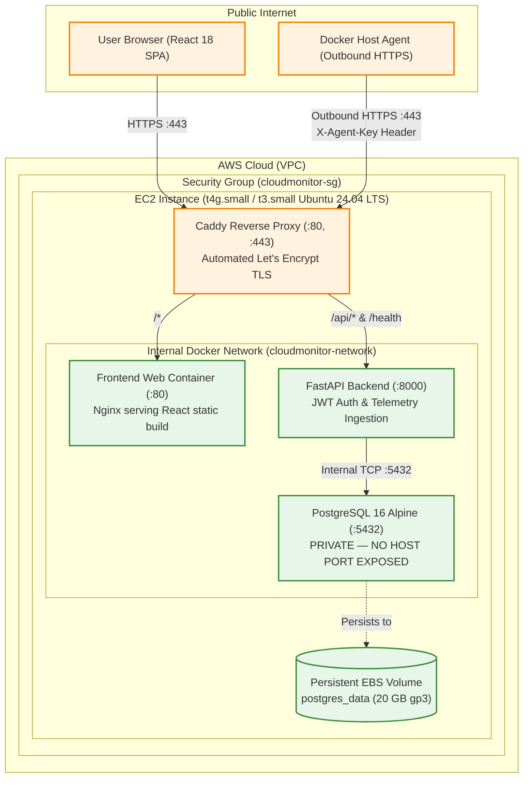

# CloudMonitor — Production AWS Deployment Guide (Lightweight Architecture)

> A production-grade, cost-optimized, and security-hardened deployment guide for hosting CloudMonitor on Amazon Web Services (AWS). Preserves the existing FastAPI backend, JWT authentication, React 18 frontend, PostgreSQL persistence layer, and lightweight outbound Docker agent.

---

## 1. Architecture Blueprint



---

## 2. Resource Inventory & Estimated Cost Breakdown

CloudMonitor follows a single-host containerized architecture designed to minimize cloud spend while ensuring persistence, security, and high reliability.

| AWS Resource | Specification | Free Tier Eligible | Estimated Monthly Cost |
| :--- | :--- | :--- | :--- |
| **Compute (EC2)** | `t4g.small` (2 vCPU, 2GB RAM, Graviton) or `t3.small` (2 vCPU, 2GB RAM, x86) | Yes (12-month Free Tier includes `t2.micro` or `t3.micro` 750 hrs/mo) | **$12.26 / month** (`t4g.small`) or **$0.00** (Free Tier `t3.micro`) |
| **Storage (EBS)** | 20 GB gp3 General Purpose SSD (3,000 IOPS, 125 MB/s baseline) | Yes (Free Tier includes 30 GB EBS / month) | **$1.60 / month** (or **$0.00** Free Tier) |
| **Elastic IP** | 1 IPv4 public address attached to running EC2 instance | Free while attached to a running instance | **$0.00 / month** |
| **TLS Certificate** | Automated Let's Encrypt TLS via Caddy | 100% Free Open Source | **$0.00 / month** |
| **Data Transfer** | AWS Outbound Internet Data Transfer | Free Tier includes 100 GB/month | **~$0.00 – $0.50 / month** |
| **Total Estimated Ongoing Cost** | | | **~$13.86 / month** *(or **$0.00** on Free Tier)* |

> [!TIP]
> **Why avoid managed AWS RDS and ALB for this phase?**
> A managed AWS RDS PostgreSQL instance (`db.t4g.micro`) costs ~$15/month + storage, and an AWS Application Load Balancer costs ~$16.50/month base + LCU fees. Combining RDS + ALB + EC2 increases baseline costs to **>$45/month**. Running containerized PostgreSQL on persistent EBS with Caddy TLS achieves identical isolation and automation on a single instance for **under $14/month**.

---

## 3. Security Architecture & Hardening Controls

### 3.1 Security Group Firewall Rules (`cloudmonitor-sg`)
Create an AWS EC2 Security Group with strict ingress boundaries:

| Direction | Type | Port Range | Protocol | Source | Rationale |
| :--- | :--- | :--- | :--- | :--- | :--- |
| **Inbound** | SSH | `22` | TCP | `YOUR_ADMIN_IP/32` | Remote server administration. **Never allow `0.0.0.0/0`**. |
| **Inbound** | HTTP | `80` | TCP | `0.0.0.0/0` | Let's Encrypt HTTP-01 challenge and automated redirect to HTTPS. |
| **Inbound** | HTTPS | `443` | TCP | `0.0.0.0/0` | Encrypted web dashboard access and agent telemetry ingestion. |
| **Inbound** | PostgreSQL | `5432` | TCP | **BLOCKED** | Database is internal to Docker network; no inbound host access. |
| **Inbound** | Docker TCP | `2375` | TCP | **BLOCKED** | Unauthenticated Docker daemon access is strictly prohibited. |
| **Outbound** | All Traffic | `All` | All | `0.0.0.0/0` | Required for OS updates, Docker image pulls, and Let's Encrypt. |

### 3.2 Docker Socket Security (`/var/run/docker.sock`)
- **Read-Only Enforcement**: The monitoring agent container mounts the host Docker socket strictly in read-only mode (`-v /var/run/docker.sock:/var/run/docker.sock:ro`).
- **No Mutating Capabilities**: In read-only mode, the agent can only read container status, CPU, and memory counters. It cannot start, kill, modify, or create containers or files on the host.
- **Port 2375 Explicitly Forbidden**: The agent codebase actively inspects its configured `DOCKER_HOST`. If configured with unauthenticated TCP port `2375`, the agent raises a fatal exception and refuses to start.

### 3.3 Database Network Isolation
In `docker-compose.prod.yml`, the `postgres` service declares `expose: ["5432"]` without any host `ports:` mapping. This ensures PostgreSQL is reachable solely by the `backend` container across the internal `cloudmonitor-network` bridge.

---

## 4. Step-by-Step AWS Provisioning Instructions

### Step 1: Launch EC2 Instance via AWS CLI or Console
Run the following AWS CLI command to provision the EC2 instance with the automated bootstrap script:

```bash
# 1. Create Key Pair (if not already existing)
aws ec2 create-key-pair \
  --key-name cloudmonitor-key \
  --query 'KeyMaterial' \
  --output text > cloudmonitor-key.pem
chmod 400 cloudmonitor-key.pem

# 2. Create Security Group
SG_ID=$(aws ec2 create-security-group \
  --group-name cloudmonitor-sg \
  --description "Security group for CloudMonitor production stack" \
  --query 'GroupId' \
  --output text)

# 3. Add Ingress Rules
# Allow SSH from your current IP only:
MY_IP=$(curl -s https://checkip.amazonaws.com)
aws ec2 authorize-security-group-ingress --group-id $SG_ID --protocol tcp --port 22 --cidr "${MY_IP}/32"
# Allow HTTP and HTTPS from anywhere:
aws ec2 authorize-security-group-ingress --group-id $SG_ID --protocol tcp --port 80 --cidr 0.0.0.0/0
aws ec2 authorize-security-group-ingress --group-id $SG_ID --protocol tcp --port 443 --cidr 0.0.0.0/0

# 4. Launch Ubuntu 24.04 LTS Instance
INSTANCE_ID=$(aws ec2 run-instances \
  --image-id resolve:ssm:/aws/service/canonical/ubuntu/server/24.04/stable/current/arm64/hvm/ebs-gp3/ami-id \
  --instance-type t4g.small \
  --key-name cloudmonitor-key \
  --security-group-ids $SG_ID \
  --block-device-mappings '[{"DeviceName":"/dev/sda1","Ebs":{"VolumeSize":20,"VolumeType":"gp3","DeleteOnTermination":false}}]' \
  --tag-specifications 'ResourceType=instance,Tags=[{Key=Name,Value=CloudMonitor-Production}]' \
  --user-data file://scripts/ec2-user-data.sh \
  --query 'Instances[0].InstanceId' \
  --output text)

echo "Provisioned instance: $INSTANCE_ID"
```

### Step 2: Allocate & Associate Elastic IP
```bash
ALLOC_ID=$(aws ec2 allocate-address --domain vpc --query 'AllocationId' --output text)
aws ec2 associate-address --instance-id $INSTANCE_ID --allocation-id $ALLOC_ID
PUBLIC_IP=$(aws ec2 describe-addresses --allocation-ids $ALLOC_ID --query 'Addresses[0].PublicIp' --output text)

echo "CloudMonitor Public IP: $PUBLIC_IP"
```

### Step 3: Configure DNS A-Record
Point your DNS domain (e.g. `cloudmonitor.yourdomain.com`) to `$PUBLIC_IP` using an `A` record with TTL 300.

---

## 5. Production Application Deployment

### Step 1: Connect to the Server
```bash
ssh -i cloudmonitor-key.pem ubuntu@$PUBLIC_IP
```

### Step 2: Clone Repository & Setup Environment
```bash
cd /opt/cloudmonitor
git clone https://github.com/YOUR_ORG/cloud_monitor.git .

# Copy production env template
cp .env.production.example .env

# Generate secure cryptographic secrets
JWT_SECRET=$(openssl rand -hex 32)
DB_PASS=$(openssl rand -base64 24 | tr -d '/+=')

# Update .env
sed -i "s/REPLACE_WITH_STRONG_RANDOM_PASSWORD_MIN_24_CHARS/${DB_PASS}/g" .env
sed -i "s/REPLACE_WITH_SECURE_RANDOM_JWT_SECRET_AT_LEAST_32_CHARS/${JWT_SECRET}/g" .env
sed -i "s/cloudmonitor.yourdomain.com/YOUR_DOMAIN_OR_ELASTIC_IP/g" .env
```

### Step 3: Launch Production Containers
```bash
docker compose -f docker-compose.prod.yml up -d --build
```

### Step 4: Run Database Migrations
```bash
docker compose -f docker-compose.prod.yml exec backend alembic upgrade head
```

### Step 5: Verify Container Health
```bash
docker compose -f docker-compose.prod.yml ps
```
All containers (`caddy`, `frontend`, `backend`, `postgres`) should report status `Up` or `healthy`.

---

## 6. Docker Agent Deployment on Client Hosts

To monitor Docker containers on any remote Linux, macOS, or Windows host:

1. Log into your hosted CloudMonitor dashboard: `https://YOUR_DOMAIN_OR_ELASTIC_IP`
2. Click **Connect Docker Environment** &rarr; **Generate New Agent Key**
3. Run the lightweight agent container on the target Docker host:

```bash
docker run -d \
  --name cloudmonitor-agent \
  --restart unless-stopped \
  -v /var/run/docker.sock:/var/run/docker.sock:ro \
  -e CLOUDMONITOR_SERVER="https://YOUR_DOMAIN_OR_ELASTIC_IP" \
  -e CLOUDMONITOR_AGENT_KEY="YOUR_GENERATED_AGENT_KEY" \
  cloudmonitor-agent:latest
```

Check the agent transmission logs:
```bash
docker logs -f cloudmonitor-agent
```
Expected output:
```text
INFO:cloudmonitor-agent:Connected to Docker daemon (version 27.x.x)
INFO:cloudmonitor-agent:Heartbeat delivered successfully to https://YOUR_DOMAIN_OR_ELASTIC_IP
INFO:cloudmonitor-agent:Ingested metrics for 4 containers successfully.
```

---

## 7. Rollback & Disaster Recovery Procedures

### 7.1 Application Rollback
If a newly deployed backend or frontend image fails health checks:

```bash
# 1. Check out previous known-good git commit
git log --oneline -n 5
git checkout <PREVIOUS_STABLE_COMMIT_HASH>

# 2. Rebuild and restart services
docker compose -f docker-compose.prod.yml up -d --build

# 3. Verify health
docker compose -f docker-compose.prod.yml exec backend curl -f http://localhost:8000/health
```

### 7.2 Database Rollback (Alembic)
If a migration needs to be reverted:

```bash
# Downgrade schema by 1 revision
docker compose -f docker-compose.prod.yml exec backend alembic downgrade -1
```

### 7.3 EBS Volume Snapshot & Disaster Recovery
Automate periodic backups of the persistent PostgreSQL volume:

```bash
# Create point-in-time snapshot of PostgreSQL data
VOLUME_ID=$(aws ec2 describe-instances --instance-ids $INSTANCE_ID \
  --query "Reservations[0].Instances[0].BlockDeviceMappings[?DeviceName=='/dev/sda1'].Ebs.VolumeId" \
  --output text)

aws ec2 create-snapshot \
  --volume-id $VOLUME_ID \
  --description "CloudMonitor PostgreSQL backup - $(date +%Y-%m-%d)"
```

---

## 8. End-to-End Verification Checklist

Verify each phase of the live deployment using the following checklist:

- [ ] **1. Public DNS & HTTPS Termination**:
  - `curl -I https://YOUR_DOMAIN/health` returns `HTTP/2 200` with valid TLS certificate.
  - Plain `http://YOUR_DOMAIN` automatically redirects (HTTP 308) to `https://`.
- [ ] **2. Database Network Isolation**:
  - `nmap -p 5432 YOUR_DOMAIN` reports port 5432 is `closed` or `filtered`.
  - Postgres container port is not published to host interface.
- [ ] **3. User Registration (`POST /api/v1/auth/register`)**:
  - Register a test account: `test@example.com` / `Password123!` &rarr; returns HTTP 201.
  - Attempting duplicate registration &rarr; returns HTTP 409 Conflict.
- [ ] **4. User Authentication & JWT (`POST /api/v1/auth/login`)**:
  - Login returns valid JWT bearer token.
  - `GET /api/v1/auth/me` with bearer token returns authenticated user profile.
- [ ] **5. Agent Enrollment (`POST /api/v1/agents/enroll`)**:
  - Modal generates key `cma_...`.
  - Key prefix is visible in database; raw secret is never stored.
- [ ] **6. Outbound Telemetry Ingestion over HTTPS**:
  - Start agent container with agent key pointing to HTTPS backend.
  - `POST /api/v1/agents/heartbeat` returns HTTP 200.
  - `POST /api/v1/metrics/ingest` returns HTTP 200 with ingested count.
- [ ] **7. Dashboard Display & Multi-Tenant Isolation**:
  - Web UI displays connected host status as **ONLINE**.
  - Real container telemetry table shows live CPU %, Memory RSS, and State.
  - Create a second test user account &rarr; verify Dashboard shows "No Docker environment connected" (strict tenant isolation).
