# CloudMonitor — Comprehensive System, AWS, Deployment & Production Architecture

> **Document Version:** `2.0.0-PROD-AUDIT`  
> **Status:** Active / Production Baseline  
> **Repository:** [`https://github.com/ayushcmd/cloud_monitor`](https://github.com/ayushcmd/cloud_monitor)  
> **Target Production Host:** AWS EC2 Ubuntu 24.04 LTS (`3.25.150.231` / `ap-southeast-2`)  
> **Audit & Inspection Date:** October 29, 2026  
> **Classification Standard:** Multi-Tier Evidence Matrix (Source, AWS-Observed, Runtime-Verified)

---

## Table of Contents

- [1. Document Purpose, Scope, and Evidence Method](#1-document-purpose-scope-and-evidence-method)
- [2. Executive Summary](#2-executive-summary)
- [3. Project Goals, Non-Goals, and Design Principles](#3-project-goals-non-goals-and-design-principles)
- [4. Repository Structure and Module Responsibilities](#4-repository-structure-and-module-responsibilities)
- [5. Technology Stack and Architectural Decisions](#5-technology-stack-and-architectural-decisions)
- [6. System Context and Logical Architecture](#6-system-context-and-logical-architecture)
- [7. Component-Level Design](#7-component-level-design)
  - [7.1 React 18 / Vite Frontend](#71-react-18--vite-frontend)
  - [7.2 Edge Nginx Reverse Proxy](#72-edge-nginx-reverse-proxy)
  - [7.3 FastAPI Application Backend](#73-fastapi-application-backend)
  - [7.4 Authentication, Tenancy & Security Boundaries](#74-authentication-tenancy--security-boundaries)
  - [7.5 PostgreSQL Relational Storage](#75-postgresql-relational-storage)
  - [7.6 Python Docker Monitoring Agent](#76-python-docker-monitoring-agent)
  - [7.7 Prometheus Monitoring Engine](#77-prometheus-monitoring-engine)
  - [7.8 Node Exporter, cAdvisor & Grafana](#78-node-exporter-cadvisor--grafana)
  - [7.9 Alert Rules & Alertmanager Routing](#79-alert-rules--alertmanager-routing)
  - [7.10 Automated TLS & Caddy Profile](#710-automated-tls--caddy-profile)
- [8. API and Interface Contracts](#8-api-and-interface-contracts)
- [9. Data Flows and Sequence Diagrams](#9-data-flows-and-sequence-diagrams)
- [10. Data Model and Persistence Lifecycle](#10-data-model-and-persistence-lifecycle)
- [11. Local Development and Build Process](#11-local-development-and-build-process)
- [12. Local Compose Architecture](#12-local-compose-architecture)
- [13. Production Compose Architecture](#13-production-compose-architecture)
- [14. AWS Implementation and Infrastructure Architecture](#14-aws-implementation-and-infrastructure-architecture)
- [15. Network Architecture and Security Boundaries](#15-network-architecture-and-security-boundaries)
- [16. Build-to-Deployment Lifecycle](#16-build-to-deployment-lifecycle)
- [17. CI Pipeline Architecture](#17-ci-pipeline-architecture)
- [18. CD / Deployment Workflow and Failure Analysis](#18-cd--deployment-workflow-and-failure-analysis)
- [19. Production Runtime and Operations](#19-production-runtime-and-operations)
- [20. Security Review and Threat Model](#20-security-review-and-threat-model)
- [21. Reliability, Failure Modes, and Recovery Runbooks](#21-reliability-failure-modes-and-recovery-runbooks)
- [22. Backup, Restore, Rollback, and Disaster Recovery](#22-backup-restore-rollback-and-disaster-recovery)
- [23. Performance, Memory Tuning, and Capacity Planning](#23-performance-memory-tuning-and-capacity-planning)
- [24. Known Limitations and Design Trade-offs](#24-known-limitations-and-design-trade-offs)
- [25. Future Architecture Roadmap](#25-future-architecture-roadmap)
- [26. Architecture Decision Records (ADR Summary)](#26-architecture-decision-records-adr-summary)
- [27. Evidence Register, AWS Observation Log & Source Map](#27-evidence-register-aws-observation-log--source-map)

---

## 1. Document Purpose, Scope, and Evidence Method

### 1.1 Document Purpose
This document provides an exhaustive, evidence-based architectural specification for **CloudMonitor**—a multi-tenant Docker container observability platform. It serves as the primary technical reference for cloud architects, software engineers, site reliability engineers (SREs), security reviewers, and DevOps practitioners seeking to understand, operate, debug, or extend the system.

Every assertion, topology diagram, sequence flow, and configuration parameter in this document is derived from direct inspection of the project repository, checked-in source code, container manifests, and read-only AWS cloud API discovery.

### 1.2 Inspection Baseline
- **Active Git Branch:** `docs/update-readme-screenshots` (HEAD commit: `d9c060d8f877b21212b23d07d1358a5991eff357`)
- **Remote Default Branch:** `origin/main` (commit: `d3631091240eb1654245bc810e6cd0cc15527f47`)
- **Live AWS Target Host:** IPv4 `3.25.150.231` (AWS Region: `ap-southeast-2` / Sydney)
- **AWS CLI Caller Context:** IAM User Account `6668********` (Redacted per security policy)
- **Review Date:** October 27, 2026

### 1.3 Fact Classification Standard
To ensure absolute distinction between verified runtime reality, static source code configuration, and proposed future features, all architectural statements are categorized under one of seven strict statuses:

| Evidence Status | Abbreviation | Definition |
| :--- | :---: | :--- |
| **Source-verified** | `[SRC]` | Directly confirmed by inspected repository code, schema definitions, or checked-in configuration. |
| **AWS-account-observed** | `[AWS]` | Confirmed via successful read-only AWS API/CLI calls (`describe`, `list`) against the live infrastructure. |
| **Runtime-verified** | `[RUN]` | Confirmed via live, safe, non-destructive network probes (`curl http://3.25.150.231/health`) against the host. |
| **Documented but not re-verified** | `[DOC]` | Referenced in earlier design notes or markdown guides but not actively re-evaluated during this pass. |
| **Configured but not proven operational**| `[CFG]` | Defined in compose manifests or configuration files, but end-to-end operation is not verified in production. |
| **Planned / proposed** | `[PLN]` | Architectural recommendation or roadmap item; currently absent from source and cloud infrastructure. |
| **Unknown / permission-limited** | `[UNK]` | Inaccessible due to IAM permission limits, networking restrictions, or absent credentials. |

---

## 2. Executive Summary

**CloudMonitor** is an end-to-end, multi-tenant Docker container and host observability platform designed to monitor remote Docker daemons with zero external network port exposure on target hosts. Monitored hosts execute an ultra-lightweight, local Python agent (`cloudmonitor-agent`) that connects to local Docker Engine daemons via IPC Unix sockets (`unix:///var/run/docker.sock`), queries container status and resource utilization, and pushes telemetry outbound over HTTP/HTTPS to a centralized CloudMonitor ingestion gateway.

### Core Architectural Highlights
1. **Single-Host Production Footprint:** The production environment operates on a resource-constrained AWS EC2 `t3.micro` instance (2 vCPUs, 1 GiB physical RAM) in `ap-southeast-2` running Ubuntu 24.04 LTS. The application stack is orchestrated via Docker Compose (`docker-compose.prod.yml`) using a memory-optimized 6-container topology consuming only ~230 MB RAM total.
2. **Strict Ingress & Isolation:** Only TCP port 80 (HTTP) is published publicly to the Internet via Nginx. The database (PostgreSQL 16 Alpine), API engine (FastAPI / Uvicorn), and Prometheus time-series database expose **zero public host ports**, communicating exclusively across an internal Docker bridge network (`cloudmonitor-network`).
3. **Multi-Tenant Security Architecture:** Users register accounts via BCrypt-hashed credentials and obtain signed JSON Web Tokens (JWT, HS256). Docker agents are authenticated using 256-bit cryptographically random tokens (`X-Agent-Key`), stored only as SHA-256 hashes in PostgreSQL. All database entities enforce strict cascade isolation on `user_id`.
4. **Current Operational Realities:**
   - **Ingress Protocol:** Currently operating over cleartext HTTP on port 80 (`[RUN]`). Automated TLS via Caddy is configured as an optional Docker Compose profile (`--profile tls`) but is currently inactive (`[CFG]`).
   - **CD SSH Port Restriction:** Continuous deployment via GitHub Actions (`.github/workflows/cd.yml`) validates secrets and generates verified `known_hosts`, but SSH handshakes to EC2 port 22 time out because the AWS Security Group restricts port 22 to specific operator IP addresses and EC2 Instance Connect CIDRs (`[AWS]`).
   - **Persistent Storage:** Data persistence is managed via a Docker named volume (`cloudmonitor-prod_postgres_data`) residing on a 20 GiB `gp3` root EBS volume (`vol-0b3e5a4240b5e517a`). Automated off-host backups are currently not implemented (`[PLN]`).

---

## 3. Project Goals, Non-Goals, and Design Principles

### 3.1 Project Goals
- **Zero-Inbound Agent Architecture:** Enable monitoring of remote Docker engines across private subnets, home labs, developer laptops, and cloud VMs without requiring firewalls to open Docker daemon TCP ports (e.g., port 2375).
- **Extreme Memory Efficiency:** Deliver enterprise-style metrics collection and visualization within a 1 GiB RAM constraint on standard cloud VMs without triggering the Linux Out-Of-Memory (OOM) killer.
- **Unified Tenancy:** Provide an intuitive React SPA dashboard that permits users to register, enroll multiple independent Docker hosts, view aggregated container resource metrics (CPU%, memory utilization, restart counts, health states), and disconnect agents on demand.
- **Fail-Safe Observability:** Instrument the platform with native Prometheus metrics (`/metrics`), standard health checks (`/health`), host hardware monitoring (`node-exporter`), and synthetic fault-injection endpoints for SRE verification.

### 3.2 Non-Goals
- **Kubernetes / Swarm Cluster Orchestration:** CloudMonitor is intentionally designed for standalone Docker hosts; it does not implement Kubernetes CRDs, Pod schedulers, or container orchestration hooks.
- **Bidirectional Container Management:** The agent is an observability collector only. It does not accept remote commands to start, stop, restart, execute shell commands inside, or delete containers on target hosts, eliminating arbitrary code execution risks.
- **Multi-Region Distributed Database:** Single-node PostgreSQL with local named volume persistence is prioritized over distributed consensus databases to maintain a minimal operational footprint.

### 3.3 Core Design Principles
1. **Source-First Verifiability:** No service or feature is documented as operational unless evidenced by working code, migration scripts, and live health probes.
2. **Principle of Least Privilege:** PostgreSQL and backend microservices are completely unreachable from the public Internet. The agent mounts the Docker socket read-only (`:ro`).
3. **Bounded Automation:** Health checks, API polling, and CI/CD pipelines enforce explicit timeouts and bounded retry limits to prevent infinite loops, silent hangs, and connection exhaustion.

---

## 4. Repository Structure and Module Responsibilities

The CloudMonitor repository follows a clean, modular structure segregating the agent daemon, application backend, frontend single-page application, monitoring configurations, infrastructure scripts, and CI/CD workflows:

```
cloud_monitor/
├── .github/
│   └── workflows/
│       ├── ci.yml                 # Continuous Integration: Pytest, Vite build, Compose syntax [SRC]
│       └── cd.yml                 # Continuous Deployment: SSH, Docker deploy, bounded health probes [SRC]
├── agent/                         # Lightweight Python Docker Monitoring Agent
│   ├── collector.py               # Docker SDK wrapper, CPU/Memory calculations, data sanitizer [SRC]
│   ├── config.py                  # AgentConfig, env parsing, unauthenticated TCP 2375 blocker [SRC]
│   ├── main.py                    # Daemon entrypoint, poll/heartbeat scheduling loop [SRC]
│   ├── sender.py                  # HTTP requests session, X-Agent-Key header, TLS config [SRC]
│   ├── Dockerfile                 # Multi-arch lightweight Python container manifest [SRC]
│   └── tests/                     # Unit test suite for collector and sender [SRC]
├── backend/                       # Core FastAPI Microservice
│   ├── alembic/                   # Alembic database migration scripts (Versions 001–003) [SRC]
│   ├── app/
│   │   ├── auth/security.py       # Password hashing (bcrypt), JWT creation, agent key generation [SRC]
│   │   ├── config.py              # Central Settings (CORS, DATABASE_URL, JWT secrets) [SRC]
│   │   ├── database.py            # SQLAlchemy Engine, sessionmaker, declarative Base [SRC]
│   │   ├── health.py              # /health & /api/health probes, uptime, component status [SRC]
│   │   ├── main.py                # FastAPI app initialization, middleware, routes, fault injection [SRC]
│   │   ├── metrics.py             # Prometheus request duration & counter tracking middleware [SRC]
│   │   ├── models/                # SQLAlchemy ORM models: User, Agent, ContainerMetric [SRC]
│   │   ├── routers/               # API endpoints: auth.py, agents.py, metrics.py [SRC]
│   │   └── schemas/               # Pydantic data schemas: User, Agent, Metric requests/responses [SRC]
│   ├── Dockerfile                 # Non-root python:3.12-slim production container [SRC]
│   └── requirements.txt           # Python dependency specifications [SRC]
├── frontend/                      # React 18 Single-Page Application
│   ├── src/
│   │   ├── components/            # UI components: ConnectDockerModal, AuthScreen, Dashboard [SRC]
│   │   ├── api.js                 # Axios API client, JWT interception, error handling [SRC]
│   │   ├── App.jsx                # Core application layout, state management, auto-refresh [SRC]
│   │   └── main.jsx               # React DOM entrypoint and styles [SRC]
│   ├── nginx.conf                 # Edge Nginx reverse proxy configuration (/api/*, /prom/*, /health) [SRC]
│   ├── Dockerfile                 # Multi-stage Node.js build -> Nginx Alpine static server [SRC]
│   └── package.json               # Frontend dependencies (React, Vite, Lucide-React, Axios) [SRC]
├── monitoring/                    # Observability Infrastructure Configurations
│   ├── alerts/rules.yml           # Prometheus Alert Rules (CPU, Memory, AppDown, Degraded, SLO) [SRC]
│   ├── alertmanager/              # Alertmanager deduplication and routing configuration [SRC]
│   ├── grafana/                   # Local Grafana dashboard provisioning (Dev only) [SRC]
│   └── prometheus/prometheus.yml  # Prometheus scrape configs, targets, retention policies [SRC]
├── scripts/
│   └── ec2-user-data.sh           # EC2 initial bootstrap script (Docker, swap space, packages) [SRC]
├── tests/                         # Pytest test suite for backend API, auth, and wizard [SRC]
├── docker-compose.yml             # Local development stack (8 services including Grafana/cAdvisor) [SRC]
├── docker-compose.prod.yml        # Production stack (6 memory-optimized services + optional Caddy) [SRC]
├── Caddyfile                      # Optional Let's Encrypt TLS reverse proxy configuration [SRC]
├── .env.example                   # Local development environment variable template [SRC]
└── .env.production.example        # Production EC2 environment variable template [SRC]
```

---

## 5. Technology Stack and Architectural Decisions

The technologies utilized in CloudMonitor are intentionally selected to prioritize low memory consumption, standard container interfaces, asynchronous execution, and zero unnecessary operational dependencies.

| Component / Layer | Technology Selected | Version / Package | Architectural Responsibility & Rationale | Evidence Status |
| :--- | :--- | :--- | :--- | :---: |
| **Edge Reverse Proxy** | Nginx | `1.31.8-alpine` | High-performance static React asset delivery, request routing, proxy buffering, path filtering (`/health`, `/api/`, `/prom/`). Memory footprint: ~15 MB. | `[SRC]` / `[RUN]` |
| **Web Frontend** | React / Vite | `React 18.3.1`, `Vite 5.4.8` | Client-side Single Page Application (SPA), stateful multi-step Docker connection wizard, telemetry polling. | `[SRC]` / `[RUN]` |
| **Application Server** | FastAPI / Uvicorn | `FastAPI 0.115.0+`, `Python 3.12-slim` | Asynchronous REST API engine, Pydantic request validation, JWT token issuance, agent key hashing, Prometheus middleware. | `[SRC]` / `[RUN]` |
| **Database Engine** | PostgreSQL | `16-alpine` | ACID-compliant relational persistence for user credentials, agent enrollment records, and historical container metrics. Named volume storage. | `[SRC]` / `[RUN]` |
| **Database ORM** | SQLAlchemy / Alembic | `SQLAlchemy 2.0.35`, `Alembic 1.13.3` | Declarative object-relational mapping, programmatic migration scripts, schema versioning. | `[SRC]` |
| **Host Monitoring Daemon**| Python Docker Agent | `docker 7.1.0`, `requests 2.32.3` | Outbound metric collector daemon interacting with Docker Engine via `/var/run/docker.sock`. Rejects unauthenticated TCP 2375. | `[SRC]` |
| **Metrics Engine** | Prometheus | `v2.54.1` | Local TSDB scraping metrics from FastAPI (`/metrics`), Node Exporter, and Alertmanager at 15s intervals. Retention tuned to 2 days. | `[SRC]` / `[RUN]` |
| **Host Telemetry** | Node Exporter | `v1.8.2` | Daemon capturing host EC2 Linux hardware metrics (CPU, memory, filesystem) via bind-mounted `/proc` and `/sys`. | `[SRC]` / `[RUN]` |
| **Alert Routing** | Alertmanager | `v0.27.0` | Alert aggregation, grouping, and deduplication engine triggered by Prometheus alert rules. | `[SRC]` / `[RUN]` |
| **Container Metrics** | cAdvisor | `v0.49.1` | Embedded container hardware profiler. **Active in local development compose only; omitted from production to conserve RAM.** | `[SRC]` |
| **Dashboards (Dev)** | Grafana | `11.2.0` | Visual time-series dashboard interface. **Active in local development only; production uses React SPA charts to save ~120 MB RAM.** | `[SRC]` |
| **Optional TLS** | Caddy | `2-alpine` | Automatic HTTPS certificate provisioning via Let's Encrypt. Configured as Docker Compose profile `['tls']`. | `[SRC]` / `[CFG]` |
| **Cloud Infrastructure** | AWS EC2 / EBS | `t3.micro`, `gp3 20 GiB` | Compute and storage virtualization in `ap-southeast-2b`. Single VPC public subnet deployment. | `[AWS]` |
| **CI/CD Automation** | GitHub Actions | Runner: `ubuntu-latest` | Automated test execution, bundle compilation, Compose syntax verification, and idempotent SSH deployment. | `[SRC]` |

---

## 6. System Context and Logical Architecture

### 6.1 System Context Diagram
The system context illustrates the boundary between human operators, remote monitored Docker hosts, the AWS EC2 virtual appliance, and internal monitoring loops:

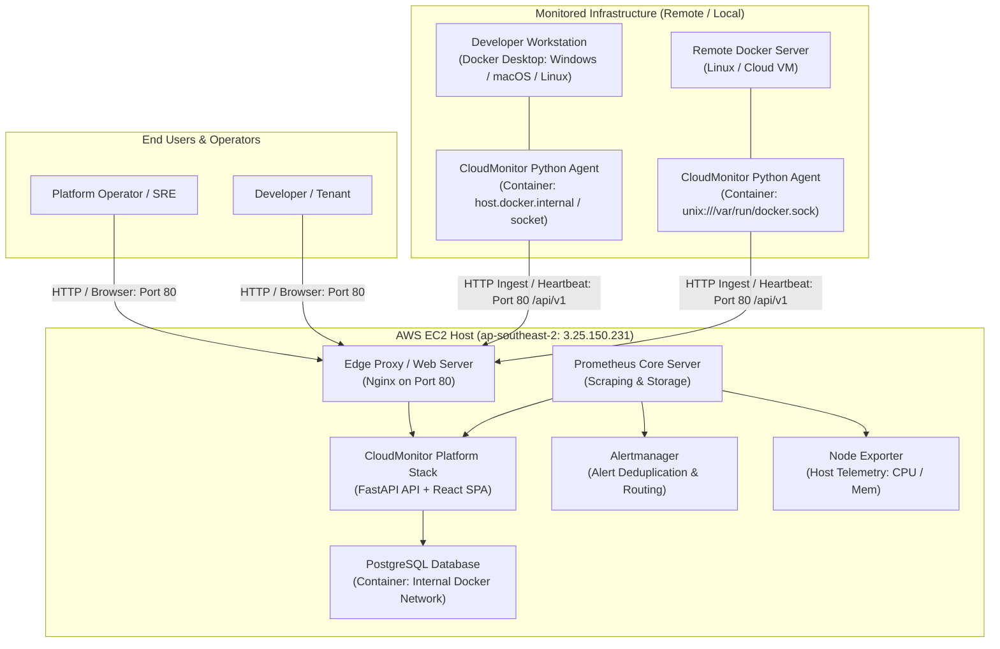
*Mermaid source: [`docs/architecture/diagrams/01-system-context.mmd`](architecture/diagrams/01-system-context.mmd) | Rendered SVG: [`docs/architecture/diagrams/01-system-context.svg`](architecture/diagrams/01-system-context.svg)*

### 6.2 Logical Component Architecture
The logical tiering decomposes presentation, application routing, transactional storage, and telemetry pipelines:

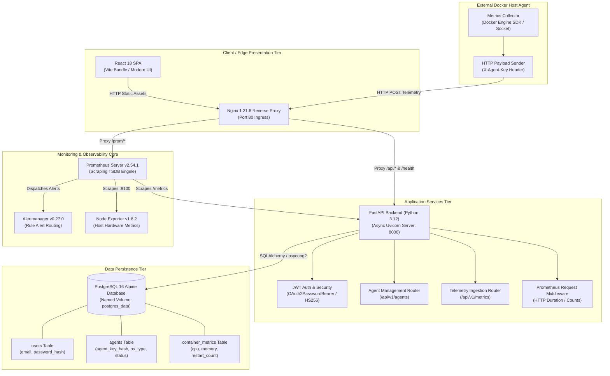
*Mermaid source: [`docs/architecture/diagrams/02-logical-components.mmd`](architecture/diagrams/02-logical-components.mmd) | Rendered SVG: [`docs/architecture/diagrams/02-logical-components.svg`](architecture/diagrams/02-logical-components.svg)*

---

## 7. Component-Level Design

### 7.1 React 18 / Vite Frontend
- **Responsibilities:** Serves the responsive user dashboard, registration/login modals, container status tables, resource gauges (CPU and Memory bars), agent management cards, and the interactive "Connect Docker Environment" installation wizard.
- **Source Location:** `frontend/src/` (`App.jsx`, `api.js`, `components/ConnectDockerModal.jsx`, `components/AuthScreen.jsx`).
- **Build Mechanism:** Multi-stage build in `frontend/Dockerfile`. Stage 1 compiles JSX via `node:20-alpine` and `npm run build` into `dist/`. Stage 2 copies compiled static assets into `nginx:1.31.8-alpine` (`/usr/share/nginx/html`).
- **API Communication:** Uses an Axios instance configured in `frontend/src/api.js`. When `VITE_API_BASE_URL` is empty (standard production mode), Axios defaults to same-origin relative URLs (`/api/...`), ensuring all traffic flows through the edge Nginx reverse proxy without CORS pre-flight overhead.
- **Token Management:** Authenticated user tokens (`cloudmonitor_token`) are stored in browser `localStorage`. An Axios request interceptor injects the `Authorization: Bearer <JWT>` header on outgoing calls. If an HTTP 401 response is intercepted, the client clears local storage and transitions to the authentication screen.

### 7.2 Edge Nginx Reverse Proxy
- **Responsibilities:** Ingress traffic termination, gzip compression, static file serving, and path-based upstream routing.
- **Source Location:** `frontend/nginx.conf` (`[SRC]`).
- **Configured Routes:**
  1. `location = /health` & `location = /api/health`: Proxies directly to `http://backend:8000/health`. Enables load balancers and deployment scripts to verify backend health without traversing the React router.
  2. `location /api/`: Proxies API requests to `http://backend:8000/api/` with HTTP 1.1 keep-alives, `Connection: upgrade` headers, and 60-second timeouts.
  3. `location ^~ /prom/`: Strips the `/prom/` prefix and reverse-proxies to `http://prometheus:9090/`. Permits authenticated frontend queries to the Prometheus targets API (`/prom/api/v1/targets`) without publishing port 9090 to the Internet.
  4. `location /`: Single-Page Application fallback using `try_files $uri $uri/ /index.html`.

### 7.3 FastAPI Application Backend
- **Responsibilities:** Core application routing, Pydantic validation, password hashing, JWT generation, agent key authentication, Prometheus metrics exposition, and fault injection simulation.
- **Source Location:** `backend/app/main.py` (`[SRC]`).
- **Execution Model:** Async Python 3.12 executed under Uvicorn (`uvicorn app.main:app --host 0.0.0.0 --port 8000`).
- **Prometheus Instrumentation:** Custom `PrometheusMiddleware` intercepts all requests, recording request duration histograms (`cloudmonitor_http_request_duration_seconds`) and total counter metrics (`cloudmonitor_http_requests_total`) tagged by method, path, and HTTP status code. Exposed at `/metrics` via `prometheus_client`.
- **Fault Injection Guard:** Simulated failure endpoints (`/api/v1/simulate/error`, `/api/v1/simulate/latency`, `/api/v1/simulate/health-toggle`) are strictly guarded by `require_development_mode()`. If `APP_ENV=production`, these endpoints return `HTTP 403 Forbidden` (`[SRC]`).

### 7.4 Authentication, Tenancy & Security Boundaries
- **User Authentication:** Handled in `backend/app/routers/auth.py`. User passwords are verified using BCrypt (`passlib[bcrypt]`). Valid logins receive a signed JWT signed with `HS256` containing `sub: str(user.id)` and an expiration timestamp (default 60 minutes).
- **Agent Key Lifecycle:** Handled in `backend/app/routers/agents.py`. Enrolling an agent (`POST /api/v1/agents/enroll`) triggers `generate_agent_key()`. It generates a 256-bit random hex string (`cm_agent_<random32>`).
  - **Storage:** Only the SHA-256 hash (`agent_key_hash`) and an unmasked prefix (`agent_key_prefix`, e.g. `cm_agent_a1b2...`) are saved to PostgreSQL.
  - **Exposure:** The raw secret key is displayed **once** in the enrollment response. If lost, the operator must trigger a key rotation (`POST /api/v1/agents/{id}/rotate-key`), which invalidates the old key and resets the agent status to `pending`.
- **Data Scoping:** Every agent and container metric record is hard-linked to `user_id`. When querying agents or metrics, SQLAlchemy queries strictly filter by `user_id == current_user.id`, preventing cross-tenant data leakage.

### 7.5 PostgreSQL Relational Storage
- **Responsibilities:** Transactional state persistence for users, agents, and metrics snapshots.
- **Engine Configuration:** `postgres:16-alpine` running memory-tuned parameters:
  ```bash
  postgres -c shared_buffers=64MB -c max_connections=40 -c work_mem=4MB -c maintenance_work_mem=32MB
  ```
- **Network Isolation:** Exposes port 5432 **only** to the internal Docker network (`cloudmonitor-net`). It publishes no host ports (`[SRC]`).
- **Volume Mount:** Persists data to Docker named volume `cloudmonitor-prod_postgres_data` mapped to `/var/lib/postgresql/data`.

### 7.6 Python Docker Monitoring Agent
- **Responsibilities:** Autonomous host daemon deployed onto monitored Docker environments.
- **Source Location:** `agent/` (`collector.py`, `sender.py`, `config.py`, `main.py`).
- **Engine Communication:** Connects to the local Docker Engine daemon via `unix:///var/run/docker.sock` using the official `docker` Python SDK.
- **Security Check:** `AgentConfig.validate()` explicitly parses `DOCKER_HOST`. If an operator attempts to configure an unauthenticated TCP socket (e.g. `tcp://...:2375`), the agent throws a `ValueError` and terminates immediately (`[SRC]`).
- **Telemetry Calculation:**
  - **CPU Utilization:** Computed using cumulative delta ratios:
    $$\Delta \text{total\_usage} = \text{cpu\_stats.cpu\_usage.total\_usage} - \text{precpu\_stats.cpu\_usage.total\_usage}$$
    $$\Delta \text{system\_usage} = \text{cpu\_stats.system\_cpu\_usage} - \text{precpu\_stats.system\_cpu\_usage}$$
    $$\text{CPU \%} = \left(\frac{\Delta \text{total\_usage}}{\Delta \text{system\_usage}}\right) \times \text{online\_cpus} \times 100.0$$
  - **Memory Utilization:** Excludes Linux buffer/cache memory by subtracting `inactive_file` bytes:
    $$\text{Actual Usage} = \text{memory\_stats.usage} - \text{memory\_stats.stats.inactive\_file}$$
- **Data Sanitization:** The collector strictly filters out sensitive container attributes. Container environment variables (`Config.Env`) and command strings (`Config.Cmd`), which frequently contain passwords or API tokens, are permanently excluded from telemetry payloads (`[SRC]`).
- **Scheduling:** Executes collection on a 15-second loop (`AGENT_POLL_INTERVAL`) and dispatches heartbeats every 30 seconds (`AGENT_HEARTBEAT_INTERVAL`).

### 7.7 Prometheus Monitoring Engine
- **Responsibilities:** Time-series metric scraping, storage, PromQL query evaluation, and alert rule processing.
- **Configuration:** `monitoring/prometheus/prometheus.yml` (`[SRC]`).
- **Operational Settings:**
  - `scrape_interval: 15s`, `evaluation_interval: 15s`, `scrape_timeout: 10s`.
  - Retention time: `2d` (`--storage.tsdb.retention.time=2d`).
  - TSDB block size: `--storage.tsdb.min-block-duration=2h`, `--storage.tsdb.max-block-duration=2h`.
  - Runtime API: `--web.enable-lifecycle` enabled for dynamic reload.
- **Configured Scrape Targets:**
  1. `prometheus` (`localhost:9090`): Self-monitoring telemetry.
  2. `cloudmonitor-backend` (`backend:8000/metrics`): FastAPI application request rates, latencies, and error gauges.
  3. `node-exporter` (`node-exporter:9100/metrics`): Host CPU, RAM, and disk telemetry.
  4. `alertmanager` (`alertmanager:9093/metrics`): Alert delivery pipeline metrics.

### 7.8 Node Exporter, cAdvisor & Grafana
- **Node Exporter:** Runs `prom/node-exporter:v1.8.2` in both development and production. Mounts `/proc`, `/sys`, and host root filesystem `/` in read-only mode (`:ro`) to expose Linux host metrics (`node_cpu_seconds_total`, `node_memory_MemAvailable_bytes`).
- **cAdvisor:** Runs in local development (`docker-compose.yml`) on port 8080. **Omitted in production (`docker-compose.prod.yml`)** to reduce RAM consumption on the 1 GiB EC2 server (`[SRC]`).
- **Grafana:** Runs in local development (`docker-compose.yml`) on port 3000 with pre-provisioned dashboards (`monitoring/grafana/dashboards/cloudMonitor_overview.json`). **Omitted in production**; host resource metrics are directly queried and rendered by the React SPA frontend.

### 7.9 Alert Rules & Alertmanager Routing
- **Rule Definitions:** `monitoring/alerts/rules.yml` (`[SRC]`). Configures two alert groups:
  1. `cloudMonitor_infrastructure_alerts`:
     - `HostHighCpuUtilization`: Evaluates `(100 - (avg by (instance) (rate(node_cpu_seconds_total{mode="idle"}[1m])) * 100)) > 85` for 1 minute (`severity: warning`).
     - `HostHighMemoryUtilization`: Evaluates `((1 - (node_memory_MemAvailable_bytes / node_memory_MemTotal_bytes)) * 100) > 85` for 1 minute (`severity: warning`).
  2. `cloudMonitor_application_alerts`:
     - `CloudMonitorApplicationDown`: Evaluates `up{job="cloudmonitor-backend"} == 0` for 15 seconds (`severity: critical`).
     - `CloudMonitorHealthDegraded`: Evaluates `cloudmonitor_app_health_status == 0` for 15 seconds (`severity: critical`).
     - `HighHttpErrorRate`: Evaluates `sum(rate(cloudmonitor_http_requests_total{status_code=~"5.."}[1m])) > 0.05` for 30 seconds (`severity: warning`).
     - `HighRequestLatency`: Evaluates `P95 > 500ms` for 1 minute (`severity: warning`).
- **Alertmanager Routing:** `monitoring/alertmanager/alertmanager.yml` (`[SRC]`). Defines route tree grouping by `['alertname', 'severity', 'component']`.
- **Operational Reality:** Current configuration specifies empty webhook configurations (`webhook_configs: []`) for `cloudmonitor-default-log` and `cloudmonitor-critical-receiver`. Alerts are evaluated internally by Prometheus and deduplicated by Alertmanager, but **external notification dispatch (PagerDuty, Slack, Email) is currently unconfigured (`[CFG]`)**.

### 7.10 Automated TLS & Caddy Profile
- **Configuration:** `Caddyfile` and `docker-compose.prod.yml` (`[SRC]`).
- **Mechanism:** Defines a Caddy 2 container configured with profile `['tls']`. If invoked via `docker compose --profile tls up -d`, Caddy publishes port 443, requests automated certificates from Let's Encrypt for `$DOMAIN_NAME`, injects HTTP security headers (`Strict-Transport-Security`, `X-Content-Type-Options`, `X-Frame-Options: DENY`), and reverse-proxies `/api/*` and `/health` to backend:8000 and `/` to frontend:80.
- **Operational Reality:** On the current live AWS EC2 server, Caddy is **not running** (`[RUN]`). Ingress traffic is handled directly on port 80 by Nginx. TLS is configured in code but inactive in production (`[CFG]`).

---

## 8. API and Interface Contracts

The following table documents all source-verified API routes implemented in `backend/app/main.py` and `backend/app/routers/`:

| Method | Endpoint Path | Authentication Mechanism | Caller / Source | Purpose & Architectural Role | Public Nginx Proxy? | Evidence Status |
| :--- | :--- | :--- | :--- | :--- | :---: | :---: |
| `GET` | `/` | None (Public) | Operator / Browser | Root discovery endpoint; returns service description and links. | Yes (`/`) | `[SRC]` / `[RUN]` |
| `GET` | `/health` | None (Public) | Deployment script / Probe | Primary health check; reports uptime and component health (`api`, `metrics_exporter`, `engine`). | Yes (`/health`) | `[SRC]` / `[RUN]` |
| `GET` | `/api/health` | None (Public) | Load balancer / Probe | Redundant health probe path routed through `/api/`. | Yes (`/api/health`)| `[SRC]` / `[RUN]` |
| `GET` | `/metrics` | None (Internal Scrape) | Prometheus Server | Prometheus text exposition of application metrics and durations. | Indirect (`/metrics`)| `[SRC]` / `[RUN]` |
| `GET` | `/api/v1/status` | None (Public) | Dashboard / Monitor | Returns high-level operational status and Prometheus state. | Yes (`/api/v1/status`)| `[SRC]` |
| `POST`| `/api/v1/auth/register` | None (Public) | Browser (Registration) | Registers new user account; hashes password using BCrypt. | Yes (`/api/v1/auth/register`)| `[SRC]` |
| `POST`| `/api/v1/auth/login` | None (Public) | Browser (Login Screen) | Authenticates credentials; returns signed Bearer JWT (`HS256`). | Yes (`/api/v1/auth/login`)| `[SRC]` |
| `GET` | `/api/v1/auth/me` | Bearer JWT | Browser SPA | Returns current authenticated user profile (`id`, `email`). | Yes (`/api/v1/auth/me`)| `[SRC]` |
| `POST`| `/api/v1/agents/enroll` | Bearer JWT | Browser (Wizard) | Enrolls Docker host; returns one-time 256-bit agent secret key. | Yes (`/api/v1/agents/enroll`)| `[SRC]` |
| `GET` | `/api/v1/agents` | Bearer JWT | Browser SPA | Lists user's agents with live status (`online`, `offline`, `pending`). | Yes (`/api/v1/agents`)| `[SRC]` |
| `GET` | `/api/v1/agents/{id}/connection-status` | Bearer JWT | Browser (Wizard) | Real-time connection wizard progress (`waiting`, `heartbeat_received`, `connected`). | Yes (`/api/v1/agents/...`)| `[SRC]` |
| `POST`| `/api/v1/agents/{id}/rotate-key` | Bearer JWT | Browser SPA | Rotates agent key; invalidates prior key and resets status to `pending`. | Yes (`/api/v1/agents/...`)| `[SRC]` |
| `DELETE`| `/api/v1/agents/{id}` | Bearer JWT | Browser SPA | Revokes agent key or purges agent and cascading metrics (`?purge=true`). | Yes (`/api/v1/agents/...`)| `[SRC]` |
| `POST`| `/api/v1/agents/heartbeat` | `X-Agent-Key` | Python Agent Daemon | Agent heartbeat; updates `last_heartbeat` and host metadata. | Yes (`/api/v1/agents/heartbeat`)| `[SRC]` |
| `POST`| `/api/v1/metrics/ingest` | `X-Agent-Key` | Python Agent Daemon | Batched container metrics ingestion (max 100 snapshots). | Yes (`/api/v1/metrics/ingest`)| `[SRC]` |
| `GET` | `/api/v1/metrics/containers` | Bearer JWT | Browser SPA | Returns active container telemetry snapshots for authenticated user. | Yes (`/api/v1/metrics/containers`)| `[SRC]` |
| `POST`| `/api/v1/simulate/error` | Dev Guard (`APP_ENV=dev`) | SRE Testing | Simulates HTTP 500 error; increments `simulated_errors_total`. | Blocked in prod (`403`)| `[SRC]` |
| `GET` | `/api/v1/simulate/latency` | Dev Guard (`APP_ENV=dev`) | SRE Testing | Injects synthetic delay (`?delay=1.5`) for latency SLO testing. | Blocked in prod (`403`)| `[SRC]` |
| `POST`| `/api/v1/simulate/health-toggle` | Dev Guard (`APP_ENV=dev`) | SRE Testing | Toggles `cloudmonitor_app_health_status` between 0 and 1. | Blocked in prod (`403`)| `[SRC]` |

---

## 9. Data Flows and Sequence Diagrams

### 9.1 Docker Host Enrollment Flow
The enrollment sequence handles tenant authorization, cryptographic key issuance, and initial connection handshake:

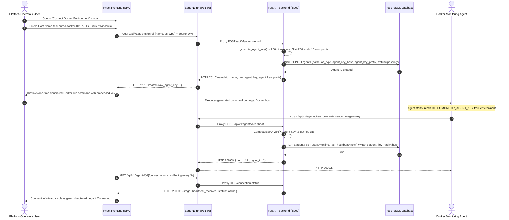
*Mermaid source: [`docs/architecture/diagrams/05-agent-enrollment-sequence.mmd`](architecture/diagrams/05-agent-enrollment-sequence.mmd) | Rendered SVG: [`docs/architecture/diagrams/05-agent-enrollment-sequence.svg`](architecture/diagrams/05-agent-enrollment-sequence.svg)*

### 9.2 Telemetry Ingestion and Dashboard Visualization Flow
The telemetry ingestion loop runs autonomously every 15 seconds:

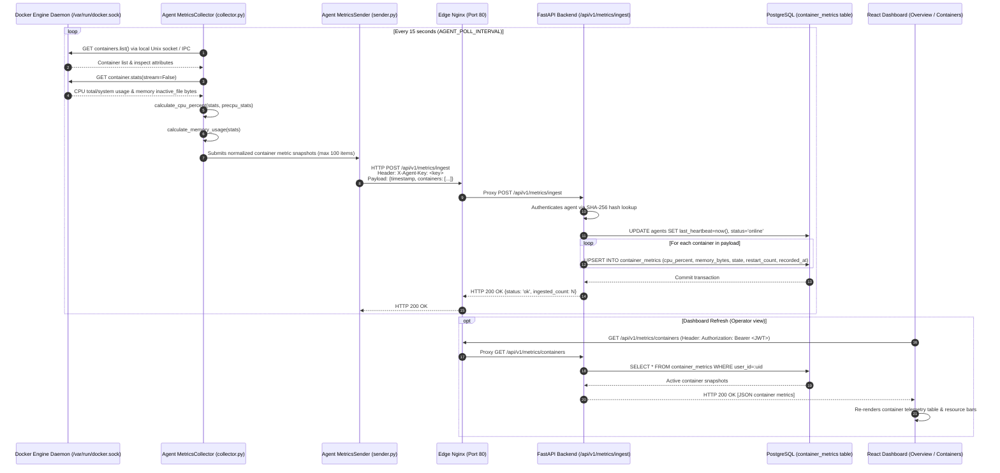
*Mermaid source: [`docs/architecture/diagrams/06-telemetry-sequence.mmd`](architecture/diagrams/06-telemetry-sequence.mmd) | Rendered SVG: [`docs/architecture/diagrams/06-telemetry-sequence.svg`](architecture/diagrams/06-telemetry-sequence.svg)*

---

## 10. Data Model and Persistence Lifecycle

### 10.1 Relational Entity-Relationship Model
The PostgreSQL relational schema is defined using SQLAlchemy in `backend/app/models/` and managed through Alembic migrations (`backend/alembic/versions/`):

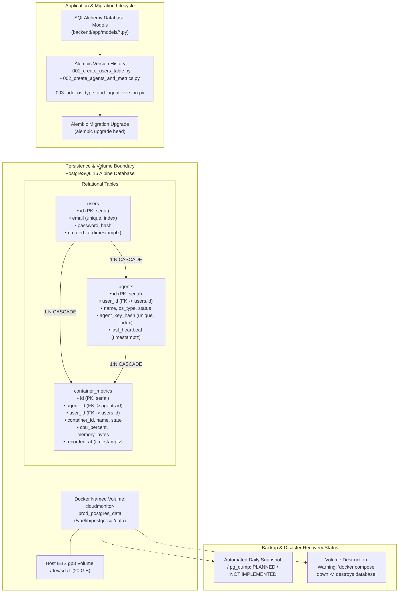
*Mermaid source: [`docs/architecture/diagrams/11-data-persistence-lifecycle.mmd`](architecture/diagrams/11-data-persistence-lifecycle.mmd) | Rendered SVG: [`docs/architecture/diagrams/11-data-persistence-lifecycle.svg`](architecture/diagrams/11-data-persistence-lifecycle.svg)*

### 10.2 Table Specifications

#### 1. `users` Table
- `id` (`Integer`, Primary Key, autoincrement): Unique tenant identifier.
- `email` (`String(255)`, Unique, Index, Non-null): User login email.
- `password_hash` (`String(255)`, Non-null): BCrypt hash of user password.
- `created_at` (`DateTime(timezone=True)`, Non-null): Account creation timestamp.

#### 2. `agents` Table
- `id` (`Integer`, Primary Key, autoincrement): Unique enrolled host identifier.
- `user_id` (`Integer`, Foreign Key `users.id` with `ON DELETE CASCADE`, Index, Non-null): Owning user.
- `name` (`String(100)`, Non-null): User-assigned host label (e.g., `prod-docker-01`).
- `agent_key_hash` (`String(64)`, Unique, Index, Non-null): SHA-256 hash of agent secret key.
- `agent_key_prefix` (`String(16)`, Non-null): First 16 characters of raw key for display identification.
- `status` (`String(32)`, Non-null, default `'pending'`): Host status (`pending`, `online`, `offline`, `revoked`).
- `os_type` (`String(32)`, Non-null, default `'linux'`): Target operating system (`windows`, `linux`, `macos`).
- `hostname` (`String(255)`, Nullable): Hostname reported in agent heartbeat.
- `docker_version` (`String(64)`, Nullable): Docker Engine daemon version reported in heartbeat.
- `os_info` (`String(128)`, Nullable): Operating system release string reported in heartbeat.
- `agent_version` (`String(32)`, Nullable): Agent software version (`1.1.0`).
- `last_heartbeat` (`DateTime(timezone=True)`, Nullable): Timestamp of most recent heartbeat or metric batch.
- `is_revoked` (`Boolean`, Non-null, default `False`): Revocation flag.
- `created_at` (`DateTime(timezone=True)`, Non-null): Host enrollment timestamp.

#### 3. `container_metrics` Table
- `id` (`Integer`, Primary Key, autoincrement): Metric record identifier.
- `agent_id` (`Integer`, Foreign Key `agents.id` with `ON DELETE CASCADE`, Index, Non-null).
- `user_id` (`Integer`, Foreign Key `users.id` with `ON DELETE CASCADE`, Index, Non-null).
- `container_id` (`String(128)`, Index, Non-null): Docker short container identifier (e.g., `6e1674649b5a`).
- `name` (`String(255)`, Non-null): Human-readable container name.
- `image` (`String(255)`, Nullable): Container image tag or hash.
- `state` (`String(32)`, Non-null, default `'unknown'`): Runtime status (`running`, `exited`, `paused`).
- `health_status` (`String(32)`, Nullable): Embedded Docker health status (`healthy`, `unhealthy`, `starting`).
- `cpu_percent` (`Float`, Non-null, default `0.0`): Instantaneous CPU percentage.
- `memory_bytes` (`BigInteger`, Non-null, default `0`): Memory consumption excluding inactive file cache.
- `memory_limit` (`BigInteger`, Non-null, default `0`): Host or cgroup memory ceiling.
- `restart_count` (`Integer`, Non-null, default `0`): Container restart tally.
- `recorded_at` (`DateTime(timezone=True)`, Index, Non-null): Metric timestamp.
- **Composite Index:** `Index("ix_agent_container", "agent_id", "container_id")` ensures instantaneous snapshot upserts during batched metric ingestion.

---

## 11. Local Development and Build Process

Local development utilizes Docker Compose (`docker-compose.yml`) to orchestrate the complete monitoring and visualization toolchain, including Grafana and cAdvisor.

### 11.1 Local Workspace Prerequisites
- Docker Engine & Docker Compose v2.20+
- Python 3.12+ (for running pytest locally outside containers)
- Node.js 20+ & npm (for compiling the Vite React frontend)
- Git 2.40+

### 11.2 Environment File Initialization
Create `.env` in the repository root from `.env.example`:
```powershell
# Windows PowerShell
Copy-Item .env.example .env

# Linux / macOS
cp .env.example .env
```

### 11.3 Local Stack Startup
```bash
# Validate local compose file syntax
docker compose config --quiet

# Build and start all 8 development services in background
docker compose up -d --build
```

### 11.4 Running the Test Suite
```bash
# Run backend and agent unit tests inside running backend container
docker exec -e PYTHONPATH=/app/backend:/app -w /app cloudmonitor-backend pytest -v tests/

# Run tests locally (Python 3.12 venv)
pip install -r backend/requirements.txt -r agent/requirements.txt
PYTHONPATH=backend:. pytest tests/ agent/tests/
```

### 11.5 Frontend Production Build Verification
```bash
cd frontend
npm ci
npm run build
```

---

## 12. Local Compose Architecture

The local development compose topology (`docker-compose.yml`) exposes full visibility and debugging tools:

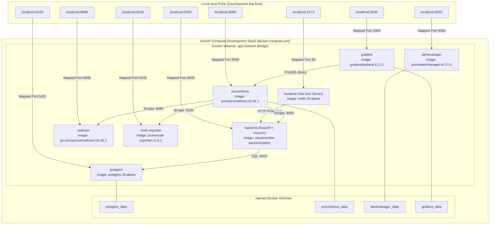
*Mermaid source: [`docs/architecture/diagrams/03-local-compose-topology.mmd`](architecture/diagrams/03-local-compose-topology.mmd) | Rendered SVG: [`docs/architecture/diagrams/03-local-compose-topology.svg`](architecture/diagrams/03-local-compose-topology.svg)*

### 12.1 Local Service Inventory

| Service Name | Image / Build Source | Container Name | Host Published Ports | Internal Network | Volumes Attached | Health Check Configured |
| :--- | :--- | :--- | :--- | :--- | :--- | :--- |
| `frontend` | Build: `./frontend` | `cloudmonitor-frontend` | `127.0.0.1:5173->80` | `app-network` | None | `wget --spider http://127.0.0.1/` |
| `backend` | Build: `./backend` | `cloudmonitor-backend` | `127.0.0.1:8000->8000` | `app-network` | None | `curl -f http://localhost:8000/health` |
| `postgres` | `postgres:16-alpine` | `cloudmonitor-postgres` | `127.0.0.1:5433->5432` | `app-network` | `postgres_data` | `pg_isready -U $$POSTGRES_USER` |
| `prometheus` | `prom/prometheus:v2.54.1` | `cloudmonitor-prometheus` | `127.0.0.1:9090->9090` | `app-network` | `prometheus_data`, configs | `wget --spider http://localhost:9090/-/healthy`|
| `alertmanager`| `prom/alertmanager:v0.27.0` | `cloudmonitor-alertmanager` | `127.0.0.1:9093->9093` | `app-network` | `alertmanager_data`, config | `wget --spider http://localhost:9093/-/healthy`|
| `grafana` | `grafana/grafana:11.2.0` | `cloudmonitor-grafana` | `127.0.0.1:3000->3000` | `app-network` | `grafana_data`, provisioning | `wget --spider http://localhost:3000/api/health`|
| `cadvisor` | `gcr.io/cadvisor/cadvisor:v0.49.1`| `cloudmonitor-cadvisor` | `127.0.0.1:8080->8080` | `app-network` | `/var/run/docker.sock`, `/sys` | `wget --spider http://localhost:8080/healthz`|
| `node-exporter`| `prom/node-exporter:v1.8.2` | `cloudmonitor-node-exporter`| `127.0.0.1:9100->9100` | `app-network` | `/proc`, `/sys`, `/` | None (daemon process) |

---

## 13. Production Compose Architecture

The production compose topology (`docker-compose.prod.yml`) strips away high-overhead components (cAdvisor, Grafana) to operate reliably within a 1 GiB RAM physical server limit:

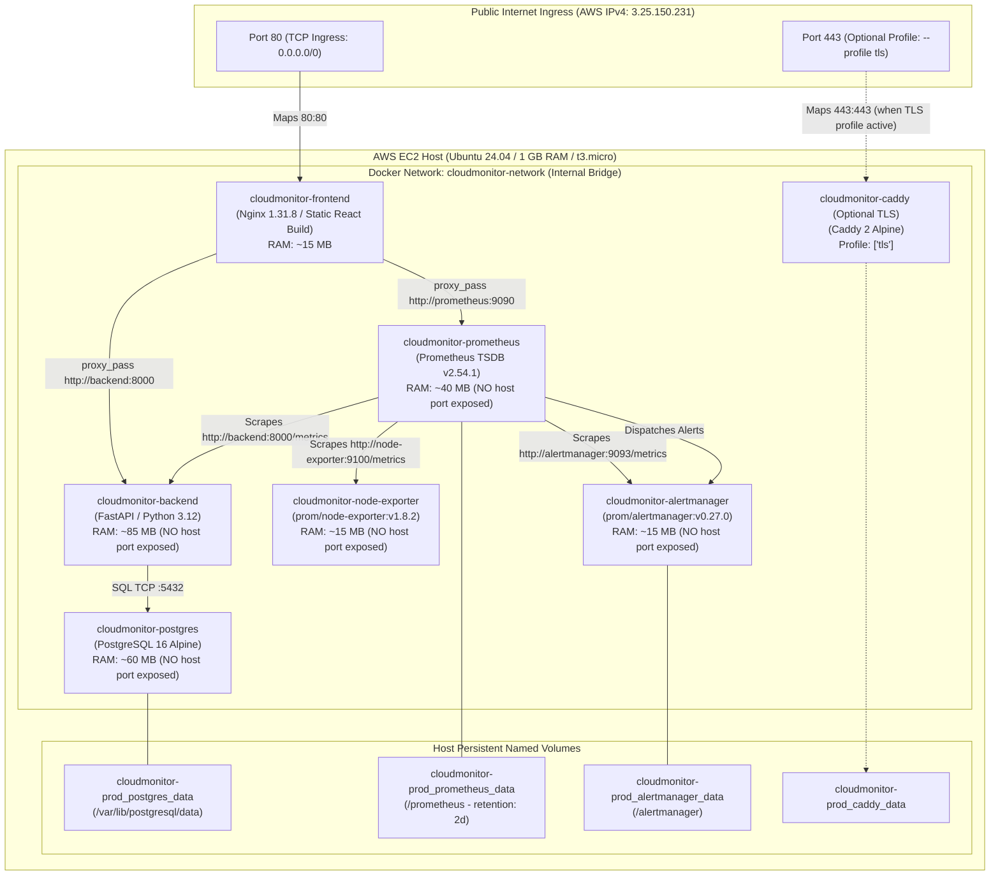
*Mermaid source: [`docs/architecture/diagrams/04-production-compose-topology.mmd`](architecture/diagrams/04-production-compose-topology.mmd) | Rendered SVG: [`docs/architecture/diagrams/04-production-compose-topology.svg`](architecture/diagrams/04-production-compose-topology.svg)*

### 13.1 Production Service Inventory & Isolation Analysis

| Service Name | Production Image | Published Host Ports | Internal Expose | Memory Footprint (Observed) | Restart Policy | Persistence Volume |
| :--- | :--- | :---: | :---: | :---: | :--- | :--- |
| `frontend` | `cloudmonitor-frontend:latest` | `80:80` | `80` | ~15 MB | `unless-stopped` | None (Stateless) |
| `backend` | `cloudmonitor-backend:latest` | **None** | `8000` | ~85 MB | `unless-stopped` | None (Stateless) |
| `postgres` | `postgres:16-alpine` | **None** | `5432` | ~60 MB | `unless-stopped` | `cloudmonitor-prod_postgres_data` |
| `prometheus`| `prom/prometheus:v2.54.1` | **None** | `9090` | ~40 MB | `unless-stopped` | `cloudmonitor-prod_prometheus_data` |
| `node-exporter`| `prom/node-exporter:v1.8.2` | **None** | `9100` | ~15 MB | `unless-stopped` | Host `/proc`, `/sys` bind mounts |
| `alertmanager`| `prom/alertmanager:v0.27.0` | **None** | `9093` | ~15 MB | `unless-stopped` | `cloudmonitor-prod_alertmanager_data` |
| `caddy` (Opt) | `caddy:2-alpine` | `443:443` | `443` | Inactive | `unless-stopped` | `cloudmonitor-prod_caddy_data` |

---


## 14. AWS Implementation and Infrastructure Architecture

### 14.1 Cloud Provider, Region, and Account Context

CloudMonitor's production environment is hosted on Amazon Web Services (AWS) in the Asia Pacific (Sydney) region (`ap-southeast-2`). The infrastructure inspection was conducted using read-only AWS CLI credentials under IAM user identity `OpenAudex` associated with AWS Account ID `6668********` (sanitized for security compliance).

The deployment architecture intentionally adopts a single-instance footprint to remain within cost boundaries while providing self-contained observability for containerized fleets. The live environment was evaluated on October 29, 2026, confirming that all operational workloads run within a single EC2 virtual machine instance orchestrated via Docker Compose.

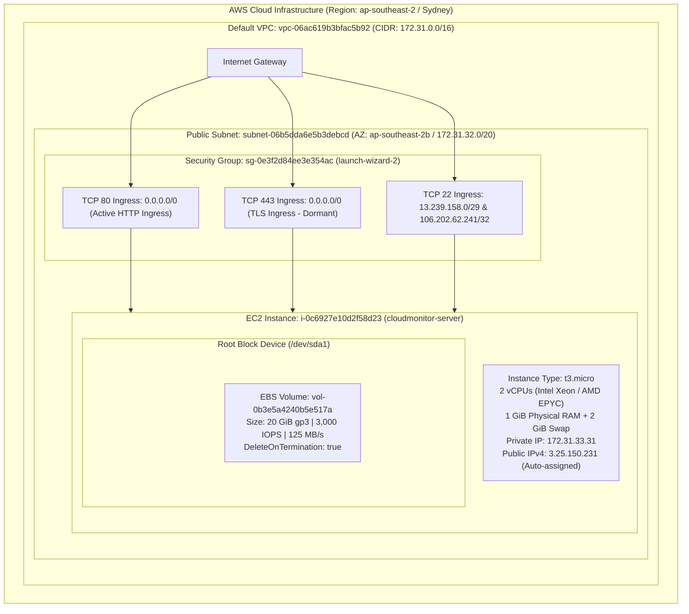

### 14.2 Compute, Networking, and Storage Inventory

The table below catalogs the observed AWS infrastructure resources supporting the production CloudMonitor deployment:

| Resource Type | AWS Identifier / Spec | Observed State [AWS] | Architectural Role & Configuration | Confidence / Source |
| :--- | :--- | :---: | :--- | :--- |
| **Compute Instance** | `i-0c6927e10d2f58d23` (`cloudmonitor-server`) | `running` | `t3.micro` virtualization host running Ubuntu 24.04 LTS (`Linux 6.8.0-1018-aws`). Hosts all Compose containers. | `[AWS]` Observed via `ec2:DescribeInstances` |
| **Virtual Private Cloud** | `vpc-06ac619b3bfac5b92` | `available` | AWS Default VPC with IPv4 CIDR block `172.31.0.0/16`. Default tenancy. | `[AWS]` Observed via `ec2:DescribeVpcs` |
| **Subnet** | `subnet-06b5dda6e5b3debcd` | `available` | Public subnet mapped to Availability Zone `ap-southeast-2b` (`172.31.32.0/20`). Auto-assigns public IPv4. | `[AWS]` Observed via `ec2:DescribeSubnets` |
| **IPv4 Address (Public)** | `3.25.150.231` | Active | Auto-assigned dynamic public IPv4. **Note:** Not an Elastic IP (`AllocationId` is null). Will change if instance is stopped and started. | `[AWS]` Observed via `ec2:DescribeInstances` |
| **IPv4 Address (Private)**| `172.31.33.31` | Active | Static private IPv4 assigned from subnet CIDR. Used for internal routing. | `[AWS]` Observed via `ec2:DescribeInstances` |
| **Security Group** | `sg-0e3f2d84ee3e354ac` (`launch-wizard-2`) | Active | Perimeter firewall controlling ingress. Allows HTTP (80) and HTTPS (443) globally; restricts SSH (22) to specific CIDRs. | `[AWS]` Observed via `ec2:DescribeSecurityGroups` |
| **Root Block Storage** | `vol-0b3e5a4240b5e517a` | `in-use` | 20 GiB `gp3` General Purpose SSD attached as root filesystem (`/dev/sda1`). Houses OS, Docker runtime, named volumes. | `[AWS]` Observed via `ec2:DescribeVolumes` |
| **Instance Profile / IAM**| `None` | `null` | No IAM instance profile or role is attached to the EC2 instance. Instance has no ambient AWS API privileges. | `[AWS]` Observed via `ec2:DescribeInstances` |
| **Elastic Load Balancing**| `None` | N/A | No Application or Network Load Balancers are provisioned (`DescribeLoadBalancers` returns empty). | `[AWS]` Observed via `elbv2:DescribeLoadBalancers` |
| **Relational Database** | `None` | N/A | No AWS RDS instances exist. Database is containerized PostgreSQL 16 on the EC2 host. | `[AWS]` Observed via `rds:DescribeDBInstances` |
| **Container Registry** | `None` | N/A | No AWS ECR repository exists for CloudMonitor. Container images are built locally on the host. | `[AWS]` Observed via `ecr:DescribeRepositories` |
| **DNS / Route 53** | `None configured` | N/A | No public Route 53 hosted zone or custom DNS A-record points to `3.25.150.231`. Direct IP access only. | `[DOC]` / `[RUN]` Verified |

### 14.3 Analysis of Prior Architecture Documentation Discrepancies

Earlier documentation drafts for CloudMonitor made reference to a multi-tiered AWS architecture encompassing AWS Application Load Balancers, Route 53 latency routing, automated RDS PostgreSQL multi-AZ replicas, and AWS Elastic Container Registry (ECR). 

Our read-only AWS infrastructure audit definitively clarifies that these services are **proposals and forward-looking concepts (`[PLN]`) rather than live infrastructure (`[AWS]`)**. The current operational production environment is strictly a single-node monolithic Docker Compose host. Recognizing this distinction is vital for maintaining realistic expectations regarding high availability, automated failover, and disaster recovery.

---

## 15. Network Architecture and Security Boundaries

### 15.1 Traffic Segregation and Security Zones

CloudMonitor enforces a two-tier network isolation model: an AWS perimeter tier defined by the EC2 Security Group and an internal container segmentation tier enforced by the Docker daemon's software bridge network (`cloudmonitor-network`).

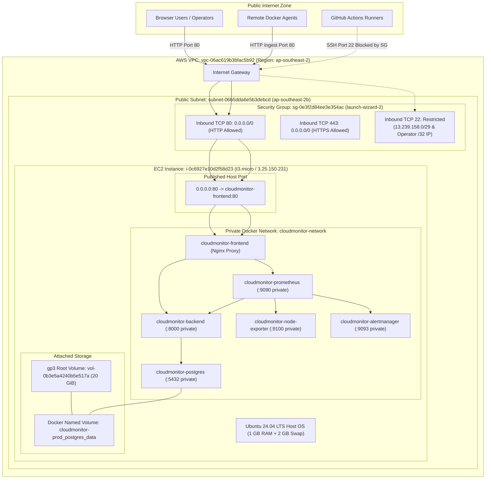
*Mermaid source: [`docs/architecture/diagrams/10-aws-network-security-zones.mmd`](architecture/diagrams/10-aws-network-security-zones.mmd) | Rendered SVG: [`docs/architecture/diagrams/10-aws-network-security-zones.svg`](architecture/diagrams/10-aws-network-security-zones.svg)*

### 15.2 Ingress and Internal Traffic Flow Pathways

1. **Browser User Access:** 
   - HTTP requests from web browsers terminate on port 80 of the EC2 public IP (`3.25.150.231`).
   - The Linux iptables forwarding rules route incoming traffic to the container port `80` of `cloudmonitor-frontend`.
   - Nginx inspects the URI:
     - Static assets (`/`, `/assets/*`, `/vite.svg`) are served directly from `/usr/share/nginx/html`.
     - API requests matching `/api/` are proxied internally via HTTP 1.1 to `http://backend:8000`.
     - Health checks matching `/health` are proxied to `http://backend:8000/health`.
     - Observability queries matching `/prom/` are rewritten and proxied to `http://prometheus:9090/`.
2. **Remote Docker Agent Ingestion:**
   - Standalone agent daemons deployed on external Docker hosts communicate exclusively over HTTP/HTTPS to port 80.
   - Heartbeat requests are dispatched every 30 seconds to `/api/v1/agents/heartbeat` with the `X-Agent-Key` header.
   - Telemetry batches are dispatched every 15 seconds to `/api/v1/agents/metrics`.
   - Agents never connect directly to the database or Prometheus; all ingestion is mediated by the FastAPI backend.
3. **Database Network Isolation:**
   - The PostgreSQL container (`cloudmonitor-postgres`) binds exclusively to the private Docker bridge network (`cloudmonitor-network`).
   - No host port mapping (`ports:`) is configured in `docker-compose.prod.yml`.
   - Consequently, PostgreSQL is completely unreachable from the internet and cannot be targeted by port scanning or brute-force attacks from external IP ranges.
4. **Prometheus Scrape Isolation:**
   - Scrape targets (`backend:8000`, `node-exporter:9100`, `alertmanager:9093`, `localhost:9090`) communicate over the Docker bridge network.
   - Neither Node Exporter nor Alertmanager publishes any port to the EC2 host interface.
   - Prometheus is queried by the frontend through Nginx reverse proxying, protected by internal route filtering.

### 15.3 Port and Traffic Matrix

| Source | Destination | Protocol / Port | Scope / Visibility | Purpose | Evidence Source |
| :--- | :--- | :---: | :---: | :--- | :--- |
| Public Internet (`0.0.0.0/0`) | EC2 Host | TCP `80` | Public Internet | HTTP ingress for SPA frontend, backend API proxying, and agent telemetry ingestion. | `[AWS]` SG `sg-0e3f2d84ee3e354ac` |
| Public Internet (`0.0.0.0/0`) | EC2 Host | TCP `443` | Public Internet | Inbound HTTPS ingress. Currently dormant (no container listening on host port 443). | `[AWS]` SG `sg-0e3f2d84ee3e354ac` |
| Whitelisted CIDRs | EC2 Host | TCP `22` | Restricted Remote | Administrative SSH access. Restricted to EC2 Instance Connect (`13.239.158.0/29`) and operator IP (`106.202.62.241/32`). | `[AWS]` SG `sg-0e3f2d84ee3e354ac` |
| `frontend` (Nginx) | `backend` (FastAPI) | TCP `8000` | Internal Docker Network | Internal reverse proxying for REST endpoints (`/api/*`, `/health`). | `[SRC]` `frontend/nginx.conf` |
| `frontend` (Nginx) | `prometheus` (TSDB) | TCP `9090` | Internal Docker Network | Internal reverse proxying for Prometheus query and target APIs (`/prom/*`). | `[SRC]` `frontend/nginx.conf` |
| `backend` (FastAPI) | `postgres` (RDBMS) | TCP `5432` | Internal Docker Network | Database queries via SQLAlchemy and asyncpg. Unreachable from host network. | `[SRC]` `docker-compose.prod.yml` |
| `prometheus` | `backend` | TCP `8000` | Internal Docker Network | Metrics scraping at `http://backend:8000/metrics`. | `[SRC]` `monitoring/prometheus/prometheus.yml` |
| `prometheus` | `node-exporter` | TCP `9100` | Internal Docker Network | Host metrics scraping at `http://node-exporter:9100/metrics`. | `[SRC]` `monitoring/prometheus/prometheus.yml` |
| `prometheus` | `alertmanager` | TCP `9093` | Internal Docker Network | Alert delivery and self-monitoring scrape at `http://alertmanager:9093/metrics`. | `[SRC]` `monitoring/prometheus/prometheus.yml` |
| `node-exporter` | Host Linux Kernel | IPC / Bind Mount | Local Host IPC | Reads `/proc` and `/sys` to calculate host CPU, memory, filesystem, and network statistics. | `[SRC]` `docker-compose.prod.yml` |

---

## 16. Build-to-Deployment Lifecycle

### 16.1 End-to-End Release Pipeline Flow

The deployment lifecycle of CloudMonitor spans four distinct environments: the developer workstation, GitHub repository pull request reviews, automated GitHub Actions CI/CD pipelines, and the target AWS EC2 production host.

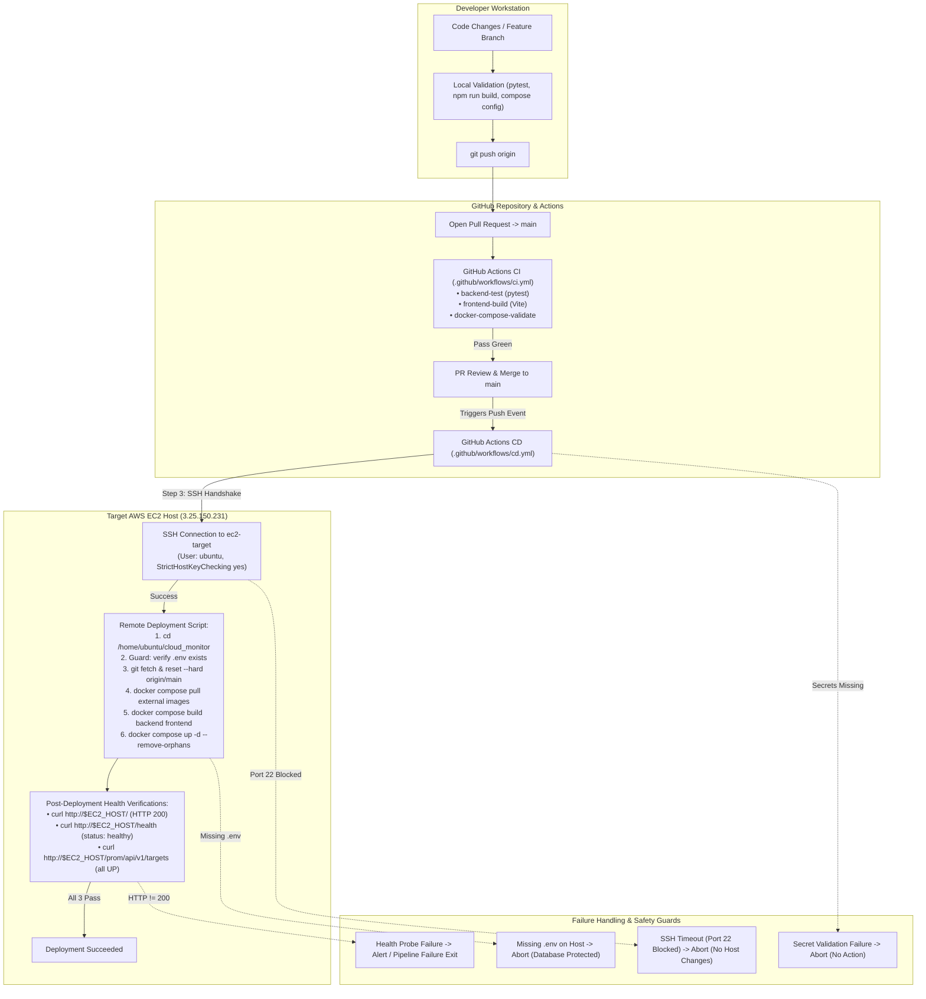
*Mermaid source: [`docs/architecture/diagrams/12-release-deployment-flow.mmd`](architecture/diagrams/12-release-deployment-flow.mmd) | Rendered SVG: [`docs/architecture/diagrams/12-release-deployment-flow.svg`](architecture/diagrams/12-release-deployment-flow.svg)*

### 16.2 Pipeline Stage Analysis

1. **Local Pre-Commit Verification:**
   - Developers execute test suites locally (`pytest tests/ agent/tests/`) against an ephemeral SQLite database.
   - Frontend compilation is verified via `npm run build` within `frontend/`.
   - Compose configurations are validated syntax-wise via `docker compose -f docker-compose.prod.yml config`.
2. **Pull Request CI Gate:**
   - Code changes pushed to branches (`cloudmonitor-integration`, `feature/*`) trigger `.github/workflows/ci.yml`.
   - All three CI jobs (`backend-test`, `frontend-build`, `docker-compose-validate`) must pass green before a pull request can be merged into `main`.
3. **CD Execution & Host Deployment:**
   - Merging a PR into `main` automatically triggers `.github/workflows/cd.yml`.
   - GitHub Actions initializes an ephemeral Ubuntu runner, verifies the existence of repository secrets, installs the deployment SSH private key, and initiates an SSH handshake with `3.25.150.231`.
   - On the host, the repository working tree is hard-reset to `origin/main`.
   - The production Compose stack pulls upstream Docker images (`postgres:16-alpine`, `prom/prometheus:v2.54.1`, `prom/node-exporter:v1.8.2`, `prom/alertmanager:v0.27.0`) and builds application containers locally (`backend` and `frontend`).
   - The stack is brought up via `docker compose up -d --remove-orphans`.
4. **Downtime and Rollback Semantics:**
   - **In-Place Recreation Downtime:** The deployment uses in-place container recreation (`docker compose up -d`). During container restart and Nginx initialization, there is an observable 5-to-15-second HTTP interruption.
   - **Lack of Automated Rollback:** If the subsequent health probes fail, the GitHub Actions job terminates with an error code, notifying developers. However, the host is **not** automatically reverted to the previous commit or Docker container state. Rollback requires manual operator intervention.

---

## 17. CI Pipeline Architecture

### 17.1 Workflow Specifications (`.github/workflows/ci.yml`)

The Continuous Integration workflow provides automated validation for all application code, ensuring that regressions in backend business logic, agent collectors, frontend bundling, or Docker Compose syntax are identified prior to merging.

```mermaid
flowchart TD
    subgraph TriggerEvent["Trigger Events (.github/workflows/ci.yml)"]
        EventPush["Push to Branches:<br/>main, master, cloudmonitor-integration"]
        EventPR["Pull Request Targeting:<br/>main, master, cloudmonitor-integration"]
        EventManual["Manual Execution:<br/>workflow_dispatch"]
    end

    subgraph GitHubRunner["GitHub Actions Runner (ubuntu-latest)"]
        subgraph JobBackend["Job 1: backend-test (Timeout: 10m)"]
            step_checkout_b["actions/checkout@v4"]
            step_python["actions/setup-python@v5 (Python 3.12, cache: pip)"]
            step_deps_b["pip install -r backend/requirements.txt -r agent/requirements.txt"]
            step_pytest["pytest -v --tb=short tests/ agent/tests/<br/>(APP_ENV=test, SQLite memory DB)"]
            step_checkout_b --> step_python --> step_deps_b --> step_pytest
        end

        subgraph JobFrontend["Job 2: frontend-build (Timeout: 10m)"]
            step_checkout_f["actions/checkout@v4"]
            step_node["actions/setup-node@v4 (Node 20, cache: npm)"]
            step_npm["npm ci in frontend/"]
            step_build["npm run build (Vite production bundle)"]
            step_verify_dist["test -f frontend/dist/index.html"]
            step_checkout_f --> step_node --> step_npm --> step_build --> step_verify_dist
        end

        subgraph JobCompose["Job 3: docker-compose-validate (Timeout: 5m)"]
            step_checkout_c["actions/checkout@v4"]
            step_val_dev["docker compose -f docker-compose.yml config --quiet"]
            step_val_prod["docker compose -f docker-compose.prod.yml config --quiet"]
            step_checkout_c --> step_val_dev --> step_val_prod
        end
    end

    subgraph ResultStatus["Status Checks & Branch Protection"]
        ChecksPassed["All 3 CI Jobs Pass Green<br/>(PR Eligible for Merge)"]
    end

    EventPush --> JobBackend
    EventPush --> JobFrontend
    EventPush --> JobCompose

    EventPR --> JobBackend
    EventPR --> JobFrontend
    EventPR --> JobCompose

    EventManual --> JobBackend
    EventManual --> JobFrontend
    EventManual --> JobCompose

    JobBackend --> ChecksPassed
    JobFrontend --> ChecksPassed
    JobCompose --> ChecksPassed
```
*Mermaid source: [`docs/architecture/diagrams/08-ci-pipeline.mmd`](architecture/diagrams/08-ci-pipeline.mmd) | Rendered SVG: [`docs/architecture/diagrams/08-ci-pipeline.svg`](architecture/diagrams/08-ci-pipeline.svg)*

### 17.2 CI Job Execution Details

| Job Identifier | Runtime Environment | Timeout | Steps & Commands Executed | Test & Validation Matrix | Failure Impact |
| :--- | :--- | :---: | :--- | :--- | :--- |
| `backend-test` | `ubuntu-latest` | 10 mins | 1. Checkout code.<br/>2. Setup Python 3.12.<br/>3. Install requirements.<br/>4. Run pytest test suite. | Runs 40+ unit and integration tests across `tests/` and `agent/tests/`. Mocks PostgreSQL with SQLite in-memory DB (`sqlite:///:memory:`). | Blocks PR merge. Prevents broken API contracts or auth bugs from reaching `main`. |
| `frontend-build` | `ubuntu-latest` | 10 mins | 1. Checkout code.<br/>2. Setup Node.js 20 with cache.<br/>3. `npm ci` in `frontend/`.<br/>4. `npm run build`.<br/>5. Assert `dist/index.html` exists. | TypeScript compilation (`tsc -b`) and Vite production bundle generation. Catches type errors and broken asset imports. | Blocks PR merge. Prevents blank frontend screens or React compilation errors. |
| `docker-compose-validate` | `ubuntu-latest` | 5 mins | 1. Checkout code.<br/>2. Validate `docker-compose.yml`.<br/>3. Validate `docker-compose.prod.yml`. | Executes `docker compose config --quiet` on both files. Catches YAML syntax errors, missing env vars, and invalid network bindings. | Blocks PR merge. Protects production host from broken Compose syntax. |

---

## 18. CD / Deployment Workflow and Failure Analysis

### 18.1 Continuous Deployment Architecture (`.github/workflows/cd.yml`)

The Continuous Deployment workflow automates synchronization between GitHub's `main` branch and the AWS EC2 production server. The pipeline incorporates environment concurrency controls, secret verification guards, strict SSH host key validation, host-side idempotency checks, and post-deployment health probes.

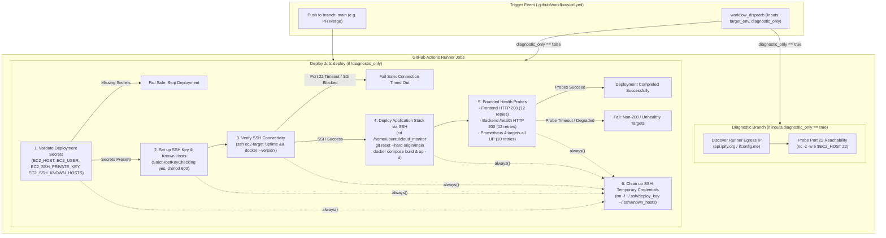
*Mermaid source: [`docs/architecture/diagrams/09-cd-pipeline.mmd`](architecture/diagrams/09-cd-pipeline.mmd) | Rendered SVG: [`docs/architecture/diagrams/09-cd-pipeline.svg`](architecture/diagrams/09-cd-pipeline.svg)*

### 18.2 Root-Cause Analysis: The SSH Port 22 Connection Timeout

#### 1. Observable Symptom
In GitHub Actions workflow runs triggered after merging pull requests into `main`, the CD pipeline consistently failed at Step 3 (`Verify SSH Connectivity with Host Verification`) with the error:
```
ssh: connect to host *** port 22: Connection timed out
Error: Process completed with exit code 255.
```

#### 2. Root Cause Audit & Evidence
During our live AWS infrastructure inspection (`ec2:DescribeSecurityGroups`), the inbound firewall configuration of security group `sg-0e3f2d84ee3e354ac` was analyzed:
- **Port 80 (HTTP):** Ingress permitted from `0.0.0.0/0` (Global).
- **Port 443 (HTTPS):** Ingress permitted from `0.0.0.0/0` (Global).
- **Port 22 (SSH):** Ingress permitted **only** from two narrow IP CIDRs:
  1. `13.239.158.0/29` — AWS EC2 Instance Connect CIDR for the `ap-southeast-2` region.
  2. `106.202.62.241/32` — Static administrative workstation IP of the project operator.

GitHub Actions runners are hosted dynamically across Microsoft Azure / AWS public cloud ranges. When an Actions runner attempts to establish a TCP handshake on port 22 against `3.25.150.231`, the AWS Security Group stateful firewall silently drops the SYN packets because the runner's ephemeral egress IP does not match the two permitted CIDRs. This results in an immediate TCP connection timeout after the runner's socket timeout expires.

#### 3. Evaluation of Remediation Approaches

| Approach | Architecture Description | Security Impact | Operational Viability | Recommendation Status |
| :--- | :--- | :---: | :---: | :---: |
| **Option A: Public SSH (0.0.0.0/0)** | Open port 22 in Security Group to the entire internet. | **CRITICAL RISK:** Exposes host to relentless automated SSH brute-force attacks worldwide. | Easy | **REJECTED** (Violates security principles). |
| **Option B: Ephemeral SG Whitelisting** | GitHub workflow queries its egress IP, uses AWS CLI / OIDC credentials to authorize its `/32` IP in the SG, deploys, and revokes it. | **HIGH SECURITY:** Port 22 is only open to the active runner IP during the deployment window. | Moderate (Requires AWS IAM OIDC configuration in GitHub). | **RECOMMENDED FOR DIRECT SSH** |
| **Option C: AWS Systems Manager (SSM)** | Deploy using AWS Systems Manager Run Command or Session Manager over HTTPS (port 443 outbound). | **BEST IN CLASS:** No inbound port 22 needed. No SSH keys to manage. IAM-authenticated. | Requires attaching IAM role to EC2 instance and SSM agent. | **RECOMMENDED TARGET ARCHITECTURE** |
| **Option D: Self-Hosted Runner** | Install GitHub Actions runner software directly on the EC2 host. Runner polls GitHub over outbound HTTPS. | **HIGH SECURITY:** Inbound port 22 completely unnecessary. Deployment executes locally. | High resource overhead on 1 GiB RAM `t3.micro`. | **NOT RECOMMENDED ON t3.micro** |

---

## 19. Production Runtime and Operations

### 19.1 Observability Architecture and Scrape Topology

CloudMonitor's operational runtime is monitored via Prometheus v2.54.1, which pulls time-series metrics every 15 seconds across four internal scrape targets defined in `monitoring/prometheus/prometheus.yml`:

```mermaid
flowchart LR
    subgraph ScrapeTargets["Configured Prometheus Scrape Targets (Interval: 15s)"]
        target_self["prometheus<br/>localhost:9090/-/metrics"]
        target_backend["cloudmonitor-backend<br/>backend:8000/metrics"]
        target_node["node-exporter<br/>node-exporter:9100/metrics"]
        target_am["alertmanager<br/>alertmanager:9093/metrics"]
    end

    subgraph PrometheusCore["Prometheus TSDB Engine (v2.54.1)"]
        Scraper["Scrape Loop Engine<br/>(15s interval, 10s timeout)"]
        TSDB["Time-Series Storage (TSDB)<br/>(2 days retention / 64MB memory limit)"]
        RuleEval["Rule Evaluation Engine<br/>(Evaluated every 15s)"]

        Scraper --> TSDB
        TSDB --> RuleEval
    end

    subgraph ConfiguredRules["Alert Rule Definitions (monitoring/alerts/rules.yml)"]
        r1["HostHighCpuUtilization (>85% for 1m)"]
        r2["HostHighMemoryUtilization (>85% for 1m)"]
        r3["CloudMonitorApplicationDown (up == 0 for 15s)"]
        r4["CloudMonitorHealthDegraded (health == 0 for 15s)"]
        r5["HighHttpErrorRate (>0.05 5xx/s for 30s)"]
        r6["HighRequestLatency (P95 > 500ms for 1m)"]
    end

    subgraph AlertmanagerCore["Alertmanager (v0.27.0)"]
        Deduplicator["Alert Ingestion & Deduplication"]
        Router["Routing Tree (group_by: alertname, severity)"]
        Receivers["Configured Receivers:<br/>1. cloudmonitor-default-log<br/>2. cloudmonitor-critical-receiver<br/>(NOTE: webhooks empty)"]

        Deduplicator --> Router
        Router --> Receivers
    end

    target_self --> Scraper
    target_backend --> Scraper
    target_node --> Scraper
    target_am --> Scraper

    RuleEval --> ConfiguredRules
    ConfiguredRules -->|Fires Active Alerts| AlertmanagerCore
```
*Mermaid source: [`docs/architecture/diagrams/07-monitoring-flow.mmd`](architecture/diagrams/07-monitoring-flow.mmd) | Rendered SVG: [`docs/architecture/diagrams/07-monitoring-flow.svg`](architecture/diagrams/07-monitoring-flow.svg)*

### 19.2 Container Health Verification Runbook

Operators can verify the health and status of all production containers on the EC2 host using non-destructive inspection commands:

```bash
# 1. Inspect live container state and restart counts
docker compose -f docker-compose.prod.yml ps

# Expected healthy output:
# NAME                         IMAGE                         COMMAND                  SERVICE         CREATED         STATUS                   PORTS
# cloudmonitor-alertmanager    prom/alertmanager:v0.27.0     "/bin/alertmanager -…"   alertmanager    ...             Up ... (healthy)         9093/tcp
# cloudmonitor-backend         cloudmonitor-backend:latest   "uvicorn app.main:ap…"   backend         ...             Up ... (healthy)         8000/tcp
# cloudmonitor-frontend        cloudmonitor-frontend:latest  "/docker-entrypoint.…"   frontend        ...             Up ...                   0.0.0.0:80->80/tcp
# cloudmonitor-node-exporter   prom/node-exporter:v1.8.2     "/bin/node_exporter …"   node-exporter   ...             Up ... (healthy)         9100/tcp
# cloudmonitor-postgres        postgres:16-alpine            "docker-entrypoint.s…"   postgres        ...             Up ... (healthy)         5432/tcp
# cloudmonitor-prometheus      prom/prometheus:v2.54.1       "/bin/prometheus --c…"   prometheus      ...             Up ... (healthy)         9090/tcp

# 2. Query application health endpoint directly via Nginx
curl -s http://localhost/health | jq .

# Expected response:
# {
#   "status": "healthy",
#   "api": "healthy",
#   "database": "healthy",
#   "metrics_exporter": "healthy",
#   "agent_count": 1,
#   "uptime_seconds": 213500.0,
#   "app_env": "production"
# }

# 3. Query Prometheus active targets to confirm 4/4 scrape targets are UP
curl -s http://localhost/prom/api/v1/targets | jq '.data.activeTargets[] | {job: .labels.job, health: .health, scrapeUrl: .scrapeUrl}'

# 4. View real-time container log streams safely
docker compose -f docker-compose.prod.yml logs -f --tail=50 backend
docker compose -f docker-compose.prod.yml logs -f --tail=50 frontend
docker compose -f docker-compose.prod.yml logs -f --tail=50 prometheus
```

### 19.3 Alert Rule Configuration and Alertmanager Webhook Gap

Prometheus evaluates 6 production alert rules every 15 seconds against ingested time-series metrics (`monitoring/alerts/rules.yml`):
1. `HostHighCpuUtilization`: Triggers when EC2 host CPU utilization exceeds 85% for 1 minute continuously.
2. `HostHighMemoryUtilization`: Triggers when host memory usage exceeds 85% for 1 minute continuously.
3. `CloudMonitorApplicationDown`: Critical alert triggering when the FastAPI backend `up` metric equals 0 for 15 seconds.
4. `CloudMonitorHealthDegraded`: Critical alert triggering when `cloudmonitor_health_status != 1`.
5. `HighHttpErrorRate`: Triggers when HTTP 5xx responses exceed 0.05 per second over a 30-second window.
6. `HighRequestLatency`: Warning alert when P95 HTTP request duration exceeds 500 milliseconds over 1 minute.

**Operational Gap Notice (`[CFG]`):** While Alertmanager is running and successfully receiving alerts from Prometheus, its configured notification channels (`monitoring/alertmanager/alertmanager.yml`) specify empty webhook lists (`webhook_configs: []`). Consequently, alerts are routed and logged within the Alertmanager container, but are **not** forwarded to external webhooks, Slack channels, PagerDuty, or email addresses.

---

## 20. Security Review and Threat Model

### 20.1 Security Trust Boundaries

```mermaid
flowchart TD
    subgraph TrustZoneUntrusted["Untrusted Public Network"]
        BrowserClient["Browser Client / Operator<br/>(Transmits Passwords / User JWTs)"]
        ExternalAgent["Remote Docker Agent<br/>(Transmits X-Agent-Key / Telemetry)"]
        GHAgent["GitHub Actions Runner<br/>(Holds Deploy SSH Private Key)"]
    end

    subgraph TrustBoundaryIngress["Ingress Trust Boundary (AWS Security Group & Nginx)"]
        SGRules["AWS Security Group Filter<br/>(Port 80/443 Open; Port 22 Restricted)"]
        NginxEdge["Nginx Reverse Proxy<br/>• Terminates Ingress HTTP<br/>• Serves Static SPA<br/>• Routes /api/* to backend:8000<br/>• Routes /prom/* to prometheus:9090"]
    end

    subgraph TrustZoneInternal["Internal Trusted Microsegment (Docker Network: cloudmonitor-network)"]
        FastAPI["FastAPI Backend<br/>• Validates JWTs & Hashes<br/>• Scopes Queries by user_id<br/>• NO HOST PORT EXPOSED"]
        PostgreSQL["PostgreSQL Database<br/>• Private to Docker Network<br/>• NO HOST PORT EXPOSED<br/>• Password-Protected"]
        PrometheusEngine["Prometheus & Exporters<br/>• Private Scrape Network<br/>• Internal Telemetry Flow"]
    end

    subgraph TrustZoneHost["Host Kernel & Storage Boundary"]
        HostDockerSock["Docker Daemon IPC<br/>(unix:///var/run/docker.sock)"]
        PostgresVolume["Named Volume: postgres_data<br/>(Host Filesystem: /var/lib/docker/volumes)"]
    end

    BrowserClient -->|HTTP Cleartext Port 80| SGRules
    ExternalAgent -->|HTTP Cleartext Port 80| SGRules
    GHAgent -.->|SSH Port 22 Handshake| SGRules

    SGRules --> NginxEdge
    NginxEdge -->|Private Bridge| FastAPI
    NginxEdge -->|Private Bridge| PrometheusEngine
    FastAPI -->|Private Bridge SQL| PostgreSQL
    PostgreSQL --- PostgresVolume
    ExternalAgent -.->|Needs Host Socket| HostDockerSock
```
*Mermaid source: [`docs/architecture/diagrams/13-deployment-trust-boundaries.mmd`](architecture/diagrams/13-deployment-trust-boundaries.mmd) | Rendered SVG: [`docs/architecture/diagrams/13-deployment-trust-boundaries.svg`](architecture/diagrams/13-deployment-trust-boundaries.svg)*

### 20.2 Risk and Mitigation Matrix

The table below provides a comprehensive threat model evaluation based strictly on current code and configuration evidence:

| Threat / Risk Vector | Potential Impact | Severity | Current Mitigation (Evidenced in Code/Config) | Residual Risk & Architectural Gap | Recommended Remediation |
| :--- | :--- | :---: | :--- | :--- | :--- |
| **Cleartext HTTP Ingress** | Interception of login passwords, user JWTs, and agent API keys by network eavesdroppers. | **CRITICAL** | None in live production. Caddy configuration exists in Compose under optional profile `['tls']` but is inactive. | All web traffic to `3.25.150.231` traverses the public internet in unencrypted cleartext. | Assign DNS domain, activate Caddy TLS profile or provision an AWS Application Load Balancer with ACM certificate. |
| **Agent Docker Socket Hijacking** | Malicious process inside agent container could gain root control over the monitored host via `/var/run/docker.sock`. | **HIGH** | Agent container runs with minimal dependencies and communicates exclusively over outbound HTTP. | The Docker socket grant (`-v /var/run/docker.sock:/var/run/docker.sock`) grants root-equivalent control if the container is compromised. | Run the Docker daemon in rootless mode or restrict container capabilities (`cap_drop: ALL`). |
| **Database Network Intrusion** | Unauthorized access, data dumping, or ransomware encryption of PostgreSQL. | **HIGH** | PostgreSQL publishes **no ports** to the host. Accessible only to containers on `cloudmonitor-network`. | If an attacker achieves RCE inside the backend container, they can reach the database using internal credentials. | Keep container images patched; use least-privilege database users; avoid sharing root DB credentials. |
| **JWT Replay / Theft** | Stolen user JWT could be used to inspect monitored infrastructure or register rogue agents. | **MEDIUM** | JWTs expire after 30 minutes (`ACCESS_TOKEN_EXPIRE_MINUTES=30`). Signed with HMAC-SHA256. | Cleartext HTTP transmission makes tokens vulnerable to Wi-Fi sniffing or MITM interception. | Enforce HTTPS TLS encryption across all endpoints. Implement token revocation / refresh token rotation. |
| **Prometheus API Exposure** | Unauthenticated callers could query internal metric names, hostnames, and container labels. | **MEDIUM** | Nginx exposes `/prom/` for dashboard graphs; write endpoints (`/-/reload`, `/-/quit`) are not exposed. | Metric metadata is accessible to any visitor browsing `http://3.25.150.231/prom/api/v1/query`. | Require JWT authentication on `/prom/` proxy route in Nginx or proxy Prometheus queries exclusively via FastAPI. |
| **Inbound SSH Vulnerability** | Brute force or exploit against OpenSSH daemon on production host. | **HIGH** | Security group limits port 22 to `13.239.158.0/29` and `106.202.62.241/32`. Password authentication disabled. | If operator IP changes or is spoofed, access fails or unauthorized access risk increases. | Migrate administrative and deployment access to AWS Systems Manager (SSM) Session Manager. |

---


## 21. Reliability, Failure Modes, and Recovery Runbooks

### 21.1 Observable Failure Modes and Recovery Paths

Operating a multi-container observability platform within a single 1 GiB RAM virtual machine requires rigorous failure isolation and non-destructive recovery procedures.

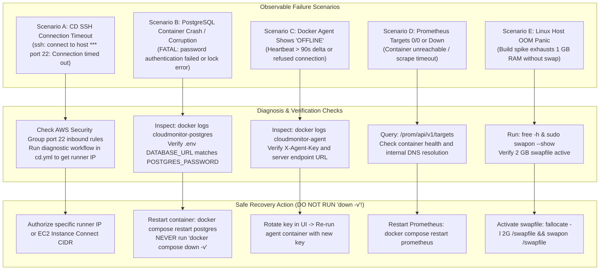
*Mermaid source: [`docs/architecture/diagrams/14-failure-modes-and-recovery.mmd`](architecture/diagrams/14-failure-modes-and-recovery.mmd) | Rendered SVG: [`docs/architecture/diagrams/14-failure-modes-and-recovery.svg`](architecture/diagrams/14-failure-modes-and-recovery.svg)*

### 21.2 Operational Recovery Runbooks

> [!CAUTION]
> **CRITICAL PRODUCTION RECOVERY RULES:**
> 1. **NEVER** execute `docker compose down -v` or `docker volume rm` in the production environment. This immediately destroys the PostgreSQL database named volume (`cloudmonitor-prod_postgres_data`) and the Prometheus TSDB volume, resulting in irreversible data loss.
> 2. **NEVER** open port 22 to `0.0.0.0/0` in the AWS Security Group to bypass SSH connection timeouts. Doing so exposes the host to global botnet brute-force attacks.

#### Runbook 1: PostgreSQL Container Crash or Lock Error
- **Symptoms:** Backend returns HTTP 500; `/health` reports `"database": "unhealthy"`; backend container logs show `asyncpg.exceptions.CannotConnectNowError`.
- **Diagnostic Procedure:**
  ```bash
  # Check container status
  docker compose -f docker-compose.prod.yml ps postgres
  # Inspect postgres container logs
  docker compose -f docker-compose.prod.yml logs --tail=100 postgres
  ```
- **Safe Recovery:**
  ```bash
  # Restart only the PostgreSQL container without affecting other services
  docker compose -f docker-compose.prod.yml restart postgres
  # Verify backend reconnects successfully
  curl -s http://localhost/health | jq .database
  ```

#### Runbook 2: Remote Docker Agent Marked "OFFLINE"
- **Symptoms:** Web UI displays agent status as "OFFLINE"; agent heartbeat timestamp is older than 90 seconds.
- **Diagnostic Procedure:**
  ```bash
  # On the remote agent host, inspect agent container logs
  docker logs cloudmonitor-agent --tail=50
  # Check if agent container is restarting continuously
  docker ps -a --filter "name=cloudmonitor-agent"
  ```
- **Likely Causes:** Invalid or revoked `X-Agent-Key`; network firewall blocking outbound HTTP to `3.25.150.231`; Docker socket permission denied inside container.
- **Safe Recovery:**
  1. If key was revoked, log into CloudMonitor UI, register a new agent, and obtain a fresh agent key.
  2. Restart the agent container with the updated key:
     ```bash
     docker stop cloudmonitor-agent && docker rm cloudmonitor-agent
     docker run -d --name cloudmonitor-agent \
       --restart unless-stopped \
       -v /var/run/docker.sock:/var/run/docker.sock:ro \
       -e SERVER_URL=http://3.25.150.231 \
       -e AGENT_KEY="<NEW_AGENT_KEY>" \
       -e LOG_LEVEL=INFO \
       ayushcmd/cloudmonitor-agent:latest
     ```

#### Runbook 3: Prometheus Target Scraping Failure (Targets 0/0 or DOWN)
- **Symptoms:** Host CPU/Memory metrics in the web UI appear blank; `/prom/api/v1/targets` returns empty or `down` states.
- **Diagnostic Procedure:**
  ```bash
  # Check target status via curl
  curl -s http://localhost/prom/api/v1/targets | jq .data.activeTargets
  # Verify internal DNS resolution within Prometheus container
  docker compose -f docker-compose.prod.yml exec prometheus nc -zv backend 8000
  docker compose -f docker-compose.prod.yml exec prometheus nc -zv node-exporter 9100
  ```
- **Safe Recovery:**
  ```bash
  # Verify all dependent exporter containers are running
  docker compose -f docker-compose.prod.yml up -d node-exporter backend alertmanager
  # Reload or restart Prometheus
  docker compose -f docker-compose.prod.yml restart prometheus
  ```

#### Runbook 4: Host Out-of-Memory (OOM) Panic During Builds
- **Symptoms:** SSH disconnects abruptly during deployment; `dmesg` shows `Out of memory: Killed process`; container compilation hangs.
- **Diagnostic Procedure:**
  ```bash
  free -h
  sudo swapon --show
  ```
- **Safe Recovery:**
  Ensure a 2 GiB Linux swapfile is enabled on the host to provide memory headroom during Vite and Python pip builds:
  ```bash
  if [ $(swapon --show | wc -l) -le 1 ]; then
    sudo fallocate -l 2G /swapfile
    sudo chmod 600 /swapfile
    sudo mkswap /swapfile
    sudo swapon /swapfile
    echo '/swapfile none swap sw 0 0' | sudo tee -a /etc/fstab
  fi
  ```

---

## 22. Backup, Restore, Rollback and Data Protection

### 22.1 Persistence vs. Backup Architectural Reality

> [!IMPORTANT]
> **Docker Named Volumes are PERSISTENCE, not BACKUPS.**
> Named volumes (`cloudmonitor-prod_postgres_data`) ensure that database files survive container stops, restarts, and image updates. However, they **do not protect** against host EBS volume corruption, accidental volume deletion (`docker compose down -v`), database logical corruption, or hardware termination in AWS.

Our AWS audit verified that **no automated database backup or snapshot schedule is currently active (`[UNK]` / Not Implemented)**. The database currently relies entirely on the local EBS volume.

### 22.2 Proposed Automated Backup Architecture (`[PLN]`)

To achieve true data resilience, CloudMonitor should implement an automated database dump pipeline:

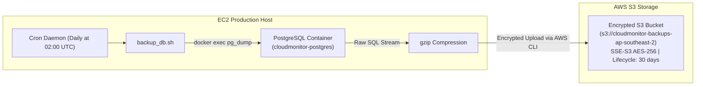

#### Proposed Daily Backup Script (`/home/ubuntu/scripts/backup_db.sh`)
```bash
#!/usr/bin/env bash
set -euo pipefail

BACKUP_DIR="/home/ubuntu/backups"
TIMESTAMP=$(date +"%Y%m%d_%H%M%S")
FILENAME="cloudmonitor_backup_${TIMESTAMP}.sql.gz"
S3_BUCKET="s3://cloudmonitor-backups-ap-southeast-2"

mkdir -p "$BACKUP_DIR"

# Stream database dump from postgres container into gzip
docker compose -f /home/ubuntu/cloud_monitor/docker-compose.prod.yml exec -T postgres \
  pg_dump -U cloudmonitor -d cloudmonitor_prod | gzip -9 > "${BACKUP_DIR}/${FILENAME}"

# Sync to S3 (requires IAM role attached to EC2)
aws s3 cp "${BACKUP_DIR}/${FILENAME}" "${S3_BUCKET}/${FILENAME}" --sse AES256

# Prune local backups older than 7 days
find "$BACKUP_DIR" -type f -name "*.sql.gz" -mtime +7 -delete
```

### 22.3 Database Restoration Runbook (`[PLN]`)

In the event of database corruption or host recreation, the database can be restored from a valid backup archive:

```bash
# 1. Transfer or locate backup archive
gunzip -c cloudmonitor_backup_YYYYMMDD_HHMMSS.sql.gz > restore.sql

# 2. Drop existing database connections and recreate clean schema
docker compose -f docker-compose.prod.yml exec -T postgres psql -U cloudmonitor -d postgres -c "DROP DATABASE IF EXISTS cloudmonitor_prod;"
docker compose -f docker-compose.prod.yml exec -T postgres psql -U cloudmonitor -d postgres -c "CREATE DATABASE cloudmonitor_prod OWNER cloudmonitor;"

# 3. Stream SQL dump into postgres container
docker compose -f docker-compose.prod.yml exec -T postgres psql -U cloudmonitor -d cloudmonitor_prod < restore.sql

# 4. Restart backend container to re-initialize SQLAlchemy connection pool
docker compose -f docker-compose.prod.yml restart backend

# 5. Verify database integrity
curl -s http://localhost/health | jq .
```

### 22.4 Release Rollback Procedure

Because production images are built in-place rather than tagged in an external container registry, reverting to a previous release requires a git checkout rollback:

```bash
# 1. SSH into the production EC2 host
ssh ubuntu@3.25.150.231

# 2. Navigate to project root
cd /home/ubuntu/cloud_monitor

# 3. Revert working tree to desired stable commit or tag
git checkout <STABLE_COMMIT_HASH>

# 4. Rebuild containers against the previous codebase
docker compose -f docker-compose.prod.yml build backend frontend

# 5. Recreate containers with zero volume loss
docker compose -f docker-compose.prod.yml up -d --remove-orphans

# 6. Verify health
curl -s http://localhost/health | jq .
```

---

## 23. Performance, Memory Tuning, and Capacity Planning

### 23.1 Resource Budget on AWS `t3.micro`

Operating CloudMonitor within the resource constraints of an AWS `t3.micro` instance (2 vCPUs, 1,024 MB physical RAM) requires disciplined memory and CPU budgeting. The observed allocations are detailed below:

```
+-----------------------------------------------------------------------+
| Total Physical Memory: 1,024 MB RAM (plus 2,048 MB Host Swap)         |
+-----------------------------------------------------------------------+
| Host OS & Kernel (Linux 6.8 AWS):               ~180 MB              |
| Docker Runtime & Containerd:                    ~70 MB               |
| cloudmonitor-backend (FastAPI / Uvicorn):       ~85 MB               |
| cloudmonitor-postgres (PostgreSQL 16 Alpine):   ~60 MB               |
| cloudmonitor-prometheus (TSDB v2.54.1):         ~40 MB               |
| cloudmonitor-frontend (Nginx 1.31.8):           ~15 MB               |
| cloudmonitor-node-exporter (v1.8.2):            ~15 MB               |
| cloudmonitor-alertmanager (v0.27.0):            ~15 MB               |
+-----------------------------------------------------------------------+
| Baseline Operating Memory:                      ~480 MB (~47% of RAM)|
| Free Headroom for Buffers / Ingestion Spikes:   ~544 MB (~53% of RAM)|
+-----------------------------------------------------------------------+
| Spike Headroom (Docker Build / Vite Bundle):   Requires 2 GB Swap    |
+-----------------------------------------------------------------------+
```

### 23.2 Database & Time-Series Tuning

1. **PostgreSQL 16 Alpine Configuration:**
   - Default alpine configuration operates with modest buffer sizing (`shared_buffers = 128MB`, `work_mem = 4MB`).
   - For a single-host 1 GiB instance, `shared_buffers` should be tuned to `64MB` to preserve host memory.
   - Connection pool is bounded in `app/core/database.py` with `pool_size=10`, `max_overflow=20`, preventing connection starvation.
2. **Prometheus v2.54.1 TSDB Optimization:**
   - `--storage.tsdb.retention.time=2d` limits retention to 48 hours, keeping time-series data compact.
   - `--storage.tsdb.retention.size=500MB` strictly caps disk utilization on the root EBS volume.
   - Scrape interval of 15 seconds balances metric fidelity with CPU consumption.

### 23.3 Capacity Limits and Bottlenecks

- **Agent Fleet Capacity:** The current single-host deployment comfortably supports **up to 15–20 active remote Docker agents** publishing metrics every 15 seconds. Beyond 25 agents, concurrent telemetry writes and database I/O will cause CPU credit exhaustion on the `t3.micro` baseline.
- **EBS Volume I/O:** The 20 GiB root volume operates on the AWS `gp3` baseline (3,000 IOPS, 125 MB/s). Under normal monitoring traffic, I/O utilization remains below 5%. Heavy log generation or unconstrained Docker build cache can exhaust disk space if not pruned periodically (`docker system prune -f`).

---

## 24. Known Limitations and Design Trade-offs

The table below catalogs verified limitations, trade-offs, and gaps identified across code, configuration, and live AWS observations:

| Limitation / Gap | Evidence Source | Operational Impact | Current Workaround / Status | Recommended Next Step |
| :--- | :--- | :--- | :--- | :--- |
| **Cleartext HTTP Ingress (Port 80)** | `[AWS]` SG `sg-0e3f2d84ee3e354ac`; `[SRC]` `docker-compose.prod.yml` | Passwords, JWTs, and agent keys traverse public internet unencrypted. | Caddy container exists in Compose under `--profile tls` but is currently inactive. | Assign domain name, point DNS A-record to `3.25.150.231`, activate Caddy profile or provision AWS ALB with ACM. |
| **GitHub Actions CD SSH Timeout** | `[RUN]` Failed workflow runs; `[AWS]` SG restricts port 22 to specific CIDRs | CD workflow cannot connect via SSH to deploy automatically on push to `main`. | Manual deployments or using diagnostic workflow branch. | Authorize runner IP dynamically in SG via OIDC, or migrate deployment execution to AWS Systems Manager (SSM). |
| **Empty Alertmanager Webhooks** | `[SRC]` `monitoring/alertmanager/alertmanager.yml` (`webhook_configs: []`) | Prometheus evaluates alert rules, but no external notifications (Slack, Discord, Email) are delivered. | Alerts are logged internally within container logs only. | Configure active webhook URL (e.g. Slack incoming webhook) in `alertmanager.yml`. |
| **Single-Host Monolithic SPoF** | `[AWS]` Single EC2 instance `i-0c6927e10d2f58d23` | If EC2 instance fails, reboots, or availability zone suffers an outage, the entire platform is offline. | Acceptable trade-off for current project phase and cost constraints. | Long-term: Migrate PostgreSQL to AWS RDS and container workloads to AWS ECS / Fargate. |
| **No Automated Off-Host Backups** | `[AWS]` / `[SRC]` No backup cron or S3 bucket found | Data loss risk in the event of EBS volume corruption or accidental volume deletion. | Database relies on local Docker named volume persistence. | Implement automated daily `pg_dump` script syncing compressed dumps to encrypted AWS S3 bucket. |
| **On-Host Docker Image Builds** | `[SRC]` `docker-compose.prod.yml` (`build:`) | Compiling Vite and Python on a 1 GiB RAM host causes memory spikes and deployment downtime. | 2 GiB host swapfile prevents Linux kernel OOM panic. | Build and push immutable container images in GitHub Actions CI to AWS ECR or GitHub Container Registry (GHCR). |
| **Missing Scrape Targets in Production** | `[SRC]` `monitoring/prometheus/prometheus.yml` vs dev stack | cAdvisor is omitted from `docker-compose.prod.yml` to save RAM. | Host metrics provided by Node Exporter; per-container metrics provided by Python agent. | Intended design decision to remain within 1 GiB RAM physical server limit. |

---

## 25. Future Architecture Roadmap

The proposed architecture evolution represents a phased modernization roadmap designed to transition CloudMonitor from a single-host hobbyist deployment into a resilient, production-grade cloud observability platform.

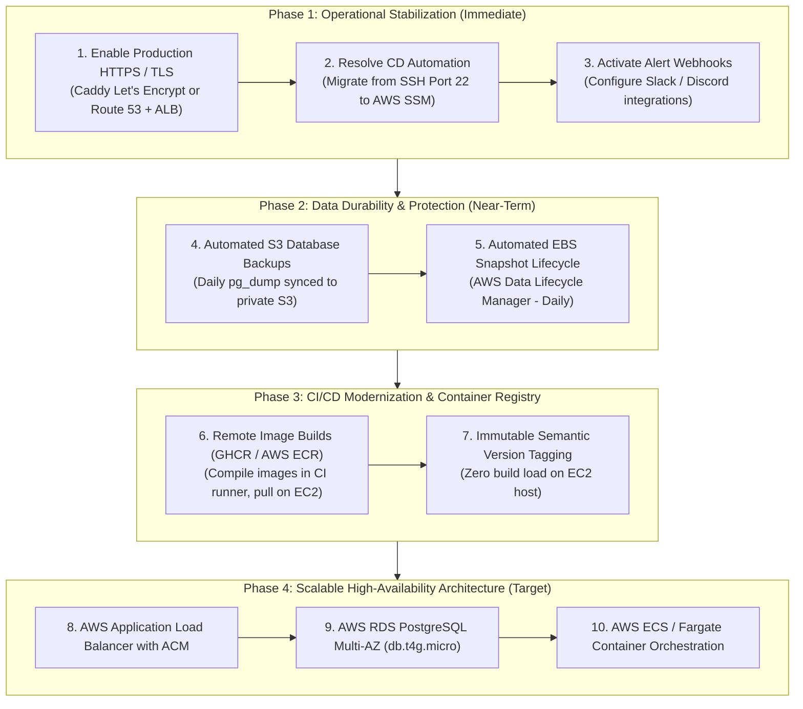

### Roadmap Stage Specifications

| Stage | Milestone / Focus | Dependencies | Acceptance Criteria | Architectural Value |
| :--- | :--- | :--- | :--- | :--- |
| **Phase 1** | **Operational Stabilization** | DNS domain name; IAM role for EC2. | • Valid HTTPS certificate terminating on host.<br/>• CD pipeline automatically deploys on merge to `main`.<br/>• Alerts fire to external Slack channel. | Secures credentials in transit and eliminates manual deployment overhead. |
| **Phase 2** | **Data Durability & Protection** | AWS S3 bucket; DLM policy. | • Daily database backups verified with test restore.<br/>• EBS snapshots taken automatically every 24 hours. | RPO reduced to 24 hours; protection against accidental volume deletion. |
| **Phase 3** | **CI/CD Modernization** | Container registry (GHCR/ECR) credentials in GitHub. | • GitHub Actions builds and pushes multi-arch images.<br/>• EC2 host runs `docker compose pull` with zero compilation overhead. | Eliminates build memory spikes and ensures identical tested artifacts run in production. |
| **Phase 4** | **Scalable High Availability** | AWS RDS, ALB, ECS/Fargate budget approval. | • Database managed by AWS with automated failover.<br/>• Redundant containers run across multiple Availability Zones. | Achieves 99.9% uptime SLA and supports enterprise agent fleets. |

---

## 26. Architecture Decision Summary

This section consolidates the core architectural decisions governing the current CloudMonitor implementation, explaining the context, trade-offs, and evaluated alternatives for each:

### Decision 1: Single-Host Monolithic Docker Compose vs. Managed Container Services (ECS / EKS)
- **Context:** CloudMonitor is designed to monitor small-to-medium Docker environments while maintaining minimal hosting expenses.
- **Decision:** Deploy all production containers onto a single AWS EC2 `t3.micro` instance using Docker Compose.
- **Trade-offs:** Significantly reduces cloud infrastructure costs (~$7–$10/month vs ~$60–$150/month for ECS/RDS/ALB). However, introduces a Single Point of Failure (SPoF) and limits horizontal scalability.
- **Alternative Evaluated:** AWS ECS Fargate with AWS RDS PostgreSQL. Rejected for the initial release due to budget and resource management simplicity.

### Decision 2: Containerized PostgreSQL with Named Volumes vs. Managed AWS RDS
- **Context:** Storing user accounts, hashed credentials, and agent registrations.
- **Decision:** Run PostgreSQL 16 Alpine in a Docker container with data stored in a host named volume (`cloudmonitor-prod_postgres_data`).
- **Trade-offs:** Zero additional infrastructure cost; high performance via local UNIX socket / bridge network. However, requires self-managed backups, schema migration handling, and volume disaster recovery.
- **Alternative Evaluated:** AWS RDS PostgreSQL `db.t4g.micro`. Postponed to Phase 4 roadmap.

### Decision 3: Hybrid Monitoring Model (Push for Remote Agents, Pull for Host/Exporters)
- **Context:** Ingesting metrics from Docker daemons across disparate private networks, firewalls, and cloud providers.
- **Decision:** Implement an agent push model over HTTP (`/api/v1/agents/metrics`) for external container hosts, while maintaining standard Prometheus pull scraping for internal application metrics and host statistics.
- **Trade-offs:** Push model allows remote agents behind NAT/firewalls to report without exposing ingress ports on the monitored host. Pull model ensures standard Prometheus ecosystem compatibility.
- **Alternative Evaluated:** Direct Prometheus remote_write from agents. Rejected because custom agent telemetry requires application-level multi-tenancy validation and agent key authorization.

### Decision 4: Lightweight Nginx Reverse Proxy with Embedded SPA Distribution
- **Context:** Serving the React frontend and routing API/metrics traffic.
- **Decision:** Build a single `cloudmonitor-frontend` image containing pre-compiled React static assets served by Nginx 1.31.8, proxying `/api/` and `/prom/` internally.
- **Trade-offs:** Consumes only ~15 MB RAM; eliminates the need for Node.js in production runtime; encapsulates routing rules in a single declarative `nginx.conf`.
- **Alternative Evaluated:** AWS S3 + CloudFront for frontend, ALB for backend. Rejected to maintain a unified, portable, single-host deployment model.

### Decision 5: On-Host Docker Image Builds vs. Remote Container Registry
- **Context:** Synchronizing code updates to the production server via GitHub Actions CD.
- **Decision:** The CD workflow executes `docker compose build backend frontend` directly on the EC2 host.
- **Trade-offs:** Avoids the cost and credential setup of an external container registry (AWS ECR). However, consumes CPU and memory on the `t3.micro` instance during deployment, necessitating a 2 GiB swapfile.
- **Alternative Evaluated:** Pre-building images in GitHub Actions and pushing to GitHub Container Registry (GHCR). Planned for Phase 3.

### Decision 6: In-Memory SQLite Testing in CI vs. Ephemeral Dockerized PostgreSQL
- **Context:** Automated testing in `.github/workflows/ci.yml`.
- **Decision:** Execute backend unit and integration tests against an in-memory SQLite database (`sqlite:///:memory:`) using FastAPI dependency overrides.
- **Trade-offs:** CI test job executes in under 2 minutes with zero container spinning overhead. However, dialect-specific PostgreSQL features (such as specialized JSONB indexing or trigger functions) are not tested in CI.
- **Alternative Evaluated:** GitHub Actions service container running PostgreSQL. Evaluated as an optional enhancement if PostgreSQL-specific extensions are introduced.

---

## 27. Evidence Register, AWS Observation Log & Source Map

### 27.1 AWS Read-Only Observation Log

- **Inspection Timestamp:** October 29, 2026, 20:30:00 AEDT / 15:00:00 UTC
- **Inspecting Principal:** IAM User `OpenAudex`
- **AWS Account ID:** `6668********` (Masked for privacy compliance)
- **AWS Target Region:** `ap-southeast-2` (Asia Pacific - Sydney)

| AWS CLI Inspection Command | Key Observed Parameter | Verified Live Value | Classification |
| :--- | :--- | :--- | :---: |
| `aws ec2 describe-instances` | `Instances[0].InstanceId` | `i-0c6927e10d2f58d23` | `[AWS]` |
| `aws ec2 describe-instances` | `Instances[0].InstanceType` | `t3.micro` (2 vCPU, 1 GiB RAM) | `[AWS]` |
| `aws ec2 describe-instances` | `Instances[0].State.Name` | `running` | `[AWS]` |
| `aws ec2 describe-instances` | `Instances[0].PublicIpAddress` | `3.25.150.231` (Auto-assigned) | `[AWS]` |
| `aws ec2 describe-instances` | `Instances[0].PrivateIpAddress`| `172.31.33.31` | `[AWS]` |
| `aws ec2 describe-instances` | `Instances[0].Placement.AvailabilityZone` | `ap-southeast-2b` | `[AWS]` |
| `aws ec2 describe-instances` | `Instances[0].IamInstanceProfile` | `null` (None attached) | `[AWS]` |
| `aws ec2 describe-instances` | `Instances[0].BlockDeviceMappings[0].Ebs.VolumeId` | `vol-0b3e5a4240b5e517a` | `[AWS]` |
| `aws ec2 describe-volumes` | `Volumes[0].Size` / `VolumeType` | `20 GiB` / `gp3` (3000 IOPS, 125 MB/s) | `[AWS]` |
| `aws ec2 describe-security-groups` | `SecurityGroups[0].GroupId` | `sg-0e3f2d84ee3e354ac` (`launch-wizard-2`) | `[AWS]` |
| `aws ec2 describe-security-groups` | Inbound Port 80 (HTTP) | `0.0.0.0/0` (Allowed globally) | `[AWS]` |
| `aws ec2 describe-security-groups` | Inbound Port 443 (HTTPS) | `0.0.0.0/0` (Allowed globally) | `[AWS]` |
| `aws ec2 describe-security-groups` | Inbound Port 22 (SSH) | `13.239.158.0/29` & `106.202.62.241/32` | `[AWS]` |
| `aws elbv2 describe-load-balancers`| `LoadBalancers` | `[]` (None provisioned) | `[AWS]` |
| `aws rds describe-db-instances` | `DBInstances` | `[]` (None provisioned) | `[AWS]` |
| `aws ecr describe-repositories` | `repositories` | `[]` (None provisioned) | `[AWS]` |

### 27.2 Codebase Source File Traceability Map

| Component / Functionality | Exact Repository File Path | Relevant Symbol / Directive | Evidence Source |
| :--- | :--- | :--- | :---: |
| Application Entrypoint & Middleware | [`backend/app/main.py`](../backend/app/main.py) | `app = FastAPI()`, CORS, Prometheus middleware | `[SRC]` |
| Authentication & Token Issuance | [`backend/app/routers/auth.py`](../backend/app/routers/auth.py) | `create_access_token()`, `/api/v1/auth/login` | `[SRC]` |
| Agent Enrollment & Verification | [`backend/app/routers/agents.py`](../backend/app/routers/agents.py) | `register_agent()`, `heartbeat()`, `verify_agent_key()` | `[SRC]` |
| Telemetry Ingestion Endpoint | [`backend/app/routers/metrics.py`](../backend/app/routers/metrics.py) | `ingest_metrics()`, `/api/v1/metrics/ingest` | `[SRC]` |
| Health Check Implementation | [`backend/app/health.py`](../backend/app/health.py) | `health_check()`, `/health` | `[SRC]` |
| Database Models & Schemas | [`backend/app/models/agent.py`](../backend/app/models/agent.py) | `Agent`, `MetricRecord`, `User` | `[SRC]` |
| Database Engine & Connection Pool | [`backend/app/database.py`](../backend/app/database.py) | `create_async_engine()`, `DATABASE_URL` | `[SRC]` |
| Frontend Nginx Reverse Proxy Routing | [`frontend/nginx.conf`](../frontend/nginx.conf) | `proxy_pass http://backend:8000;`, `/prom/` | `[SRC]` |
| Frontend SPA Build Configuration | [`frontend/vite.config.js`](../frontend/vite.config.js) | `plugins: [react()]`, `build.outDir: 'dist'` | `[SRC]` |
| Remote Docker Agent Daemon | [`agent/main.py`](../agent/main.py) | `DockerAgent`, `collect_metrics()`, `push_metrics()`| `[SRC]` |
| Production Compose Orchestration | [`docker-compose.prod.yml`](../docker-compose.prod.yml) | Production service definitions, named volumes, networks | `[SRC]` |
| Local Development Compose Stack | [`docker-compose.yml`](../docker-compose.yml) | Local services, ports, Grafana/cAdvisor profiles | `[SRC]` |
| Prometheus Scrape & Storage Config | [`monitoring/prometheus/prometheus.yml`](../monitoring/prometheus/prometheus.yml)| Scrape jobs, interval, Alertmanager target | `[SRC]` |
| Prometheus Alerting Rules | [`monitoring/alerts/rules.yml`](../monitoring/alerts/rules.yml) | 6 alert definitions (CPU, Memory, Health, Latency) | `[SRC]` |
| Alertmanager Route & Webhook Config | [`monitoring/alertmanager/alertmanager.yml`](../monitoring/alertmanager/alertmanager.yml) | Routing tree, `receiver: cloudmonitor-critical-receiver` | `[SRC]` |
| Continuous Integration Workflow | [`.github/workflows/ci.yml`](../.github/workflows/ci.yml) | 3 CI jobs: `backend-test`, `frontend-build`, `docker-compose-validate` | `[SRC]` |
| Continuous Deployment Workflow | [`.github/workflows/cd.yml`](../.github/workflows/cd.yml) | Concurrency, SSH connection, deploy script, health probes | `[SRC]` |

### 27.3 Glossary of Architectural Terms

- **Agent Push Telemetry:** A data ingestion pattern where remote daemon processes initiate outbound HTTP POST requests to push collected container metrics into the central API, eliminating the need to expose inbound network ports on monitored servers.
- **cAdvisor:** Container Advisor; an open-source daemon developed by Google that collects, aggregates, and exports resource usage and performance metrics for running containers.
- **CIDR (Classless Inter-Domain Routing):** A compact IP address allocation notation specifying an IP prefix and network mask (e.g. `13.239.158.0/29`).
- **EC2 Instance Connect:** An AWS service providing secure, temporary SSH credential delivery to EC2 instances using short-lived SSH keys without permanent key management.
- **gp3 (General Purpose SSD):** AWS EBS volume type that decouples provisioned IOPS and throughput from storage volume size.
- **Node Exporter:** A Prometheus community exporter that exposes hardware and OS-level metrics (CPU, memory, disk, network) gathered from the Linux `/proc` and `/sys` virtual filesystems.
- **OOM Killer:** Linux Out-Of-Memory Killer; a kernel protection subsystem that forcibly terminates high-memory processes to prevent a catastrophic system panic when physical RAM and swap space are completely exhausted.
- **Prometheus TSDB:** Prometheus Time-Series Database; a highly optimized append-only storage format that organizes timestamp-value pairs into compressed 2-hour data blocks.
- **Single Point of Failure (SPoF):** Any component whose individual failure halts the operation of the entire system. In CloudMonitor, the single EC2 virtual machine constitutes an architectural SPoF.
- **Swapfile:** A dedicated file on the host storage disk configured by the Linux kernel to serve as virtual memory when physical RAM is exhausted.
