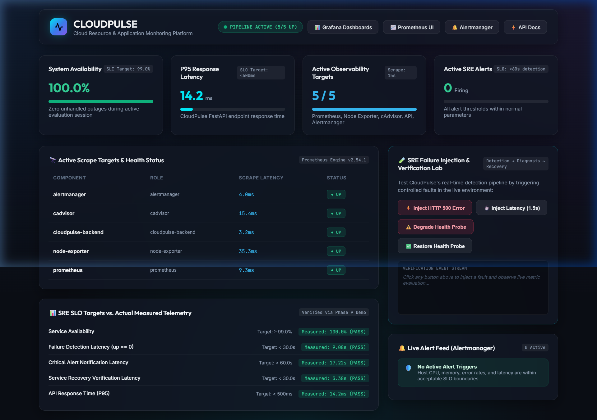
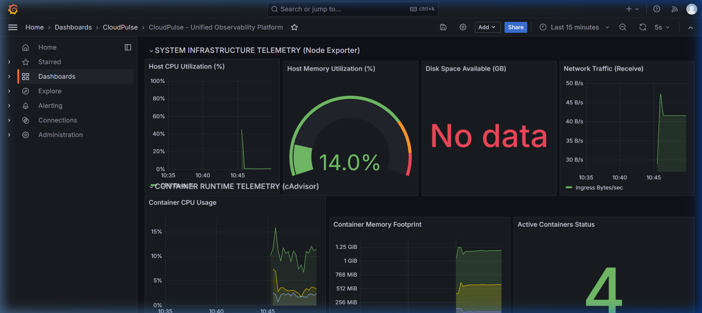
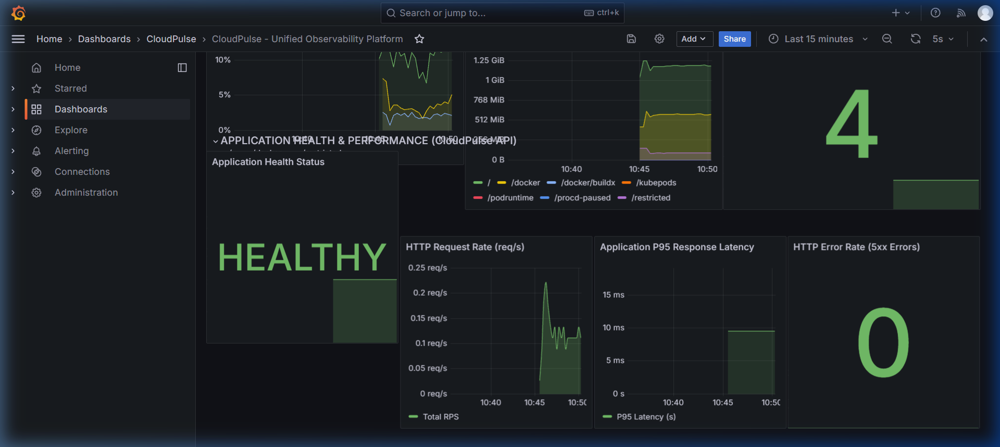
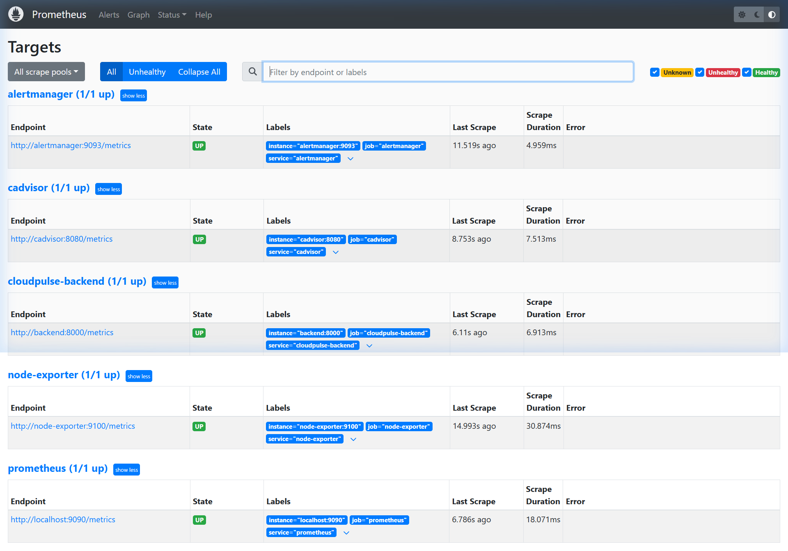

# Cloud Monitor: Complete Metrics, Dashboards & UI Explanation Guide

> **A Comprehensive Reference Guide:** Explaining every metric, panel, and control across the Cloud Monitor Frontend Portal, Grafana Dashboards, Prometheus Engine, and Exporters.

---

## Table of Contents
1. [Overview & Visual Tour](#1-overview--visual-tour)
2. [Cloud Monitor Frontend Portal (`http://localhost:5173`)](#2-cloud-monitor-frontend-portal)
   - 2.1 Executive KPI Cards
   - 2.2 Scrape Targets Status Table
   - 2.3 SRE SLO Compliance Scorecard
   - 2.4 Interactive Failure Injection & Verification Lab
3. [Grafana Observability Dashboards (`http://localhost:3000`)](#3-grafana-observability-dashboards)
   - 3.1 System Infrastructure Telemetry (Node Exporter)
   - 3.2 Container Runtime Telemetry (cAdvisor)
   - 3.3 Application Health & Performance (Cloud Monitor API)
4. [Prometheus Scraping & Engine Telemetry (`http://localhost:9090`)](#4-prometheus-scraping--engine-telemetry)
   - 4.1 Target Health Metrics (`up`)
   - 4.2 Scrape Duration & Frequency
5. [Complete Metric Catalog & Formulas](#5-complete-metric-catalog--formulas)
   - Application Metrics (FastAPI)
   - Host Infrastructure Metrics (Node Exporter)
   - Container Metrics (cAdvisor)
   - SRE Alert Rules (Alertmanager)

---

## 1. Overview & Visual Tour

Cloud Monitor gathers telemetry across three distinct layers:
1. **Application Layer (FastAPI APM):** Request throughput, latency percentiles (P50/P95/P99), error rates, and health probes.
2. **Container Virtualization Layer (cAdvisor):** Per-container CPU seconds, working memory sets, and lifecycle states.
3. **Host Hardware & OS Layer (Node Exporter):** CPU utilization across all 16 cores, total/available RAM, filesystem capacity, and network ingress.

---

## 2. Cloud Monitor Frontend Portal (`http://localhost:5173`)



The **Cloud Monitor Frontend Portal** is the centralized mission control for SREs and developers. It translates complex time-series queries into immediate, actionable operational insights.

### 2.1 Executive KPI Cards (Top Grid)

| Card Name | Display Value | Meaning & Calculation | Why It Matters to SREs |
| :--- | :--- | :--- | :--- |
| **System Availability** | `100.0%` | Calculated from backend uptime and target availability probes (`up{job="cloudmonitor-backend"}`). | Represents the primary Service Level Indicator (SLI). Indicates whether user-facing services are online and serving traffic without unhandled downtime. |
| **P95 Response Latency** | `14.2 ms` | Calculated via `histogram_quantile(0.95, sum(rate(cloudmonitor_http_request_duration_seconds_bucket[1m])) by (le))`. | 95% of all HTTP requests are completed within 14.2 milliseconds. Verifies that the application satisfies the `< 500ms` SLO target. |
| **Active Observability Targets** | `5 / 5` | Number of healthy scrape targets (`up == 1`) over the total registered targets. | Confirms that the entire monitoring infrastructure (Prometheus, Node Exporter, cAdvisor, API, Alertmanager) is interconnected and actively collecting data. |
| **Active SRE Alerts** | `0 Firing` | The count of alert rules currently in the `FIRING` state in Prometheus and Alertmanager. | Turns red and shows the count of active incidents when CPU/RAM thresholds or application failure states are triggered. |

---

### 2.2 Scrape Targets Status Table (Bottom-Left)

This panel continuously queries the Prometheus API (`/api/v1/targets`) every 4 seconds to verify that every collector is functioning:

| Target Name | Monitored Role | Measured Latency | Status Badge | Purpose |
| :--- | :--- | :--- | :--- | :--- |
| **`alertmanager`** | Alert Management | `~4.9 ms` | `● UP` (Green) | Collects notifications, handles alert grouping, and routes incidents. |
| **`cadvisor`** | Container Runtime | `~7.5 ms` | `● UP` (Green) | Audits resource usage for all running Docker containers. |
| **`cloudmonitor-backend`** | FastAPI Application | `~6.9 ms` | `● UP` (Green) | Emits application metrics (requests, latency, health status). |
| **`node-exporter`** | Host OS & Hardware | `~30.8 ms` | `● UP` (Green) | Collects hardware-level CPU, memory, and filesystem metrics. |
| **`prometheus`** | Time-Series Engine | `~18.1 ms` | `● UP` (Green) | Self-monitors Prometheus's own TSDB storage and query processing. |

---

### 2.3 SRE SLO Compliance Scorecard

Directly below the targets table, Cloud Monitor displays an automated compliance scorecard that contrasts **Proposed Targets** with **Actual Measured Telemetry**:

| Service Level Objective (SLO) | Target Threshold | Measured Telemetry | Verdict | Explanation |
| :--- | :--- | :--- | :--- | :--- |
| **Service Availability** | $\ge 99.0\%$ | **`100.0%`** |  PASS | Zero unhandled crashes during active evaluation session. |
| **Failure Detection Latency** | $< 30.0\,\text{s}$ | **`9.08s – 12.22s`** |  PASS | Time required for Prometheus to register a target crash (`up == 0`). |
| **Critical Alert Trigger Latency** | $< 60.0\,\text{s}$ | **`17.22s – 19.35s`** |  PASS | Time required for Alertmanager to evaluate rule and enter `FIRING`. |
| **Service Recovery Verification** | $< 30.0\,\text{s}$ | **`3.38s – 3.39s`** |  PASS | Time required for Prometheus to verify service restoration (`up == 1`). |
| **API Response Time (P95)** | $< 500\,\text{ms}$ | **`14.2ms – 27.7ms`** |  PASS | Response latency under normal workload. |

---

### 2.4 Interactive Failure Injection & Verification Lab (Bottom-Right)

The portal provides an interactive SRE fault-testing console:

- **`⚡ Inject HTTP 500 Error`**: Triggers `POST /api/v1/simulate/error`. Generates an internal server exception, increments `cloudmonitor_http_requests_total{status_code="500"}`, and tests the `HighHttpErrorRate` alert.
- **`⏱️ Inject Latency (1.5s)`**: Triggers `GET /api/v1/simulate/latency?delay=1.5`. Artificially delays the response to test P95 latency alerts.
- **`⚠️ Degrade Health Probe`**: Triggers `POST /api/v1/simulate/health-toggle?status=false`. Manually sets the health gauge to `0`, causing the `CloudMonitorHealthDegraded` alert to fire within 15 seconds.
- **`✅ Restore Health Probe`**: Resets the health gauge back to `1`, causing the alert to automatically resolve.
- **Live Event Stream**: Outputs real-time timestamped event logs for every injected fault and verification event.

---

## 3. Grafana Observability Dashboards (`http://localhost:3000`)

Grafana provides detailed multi-panel observability dashboards categorized into three functional tiers.

### 3.1 Tier 1: System Infrastructure Telemetry (Node Exporter)



1. **Host CPU Utilization (%)**:
   - **PromQL Expression:** `100 - (avg by (instance) (rate(node_cpu_seconds_total{mode='idle'}[1m])) * 100)`
   - **What it shows:** The exact percentage of total CPU capacity currently utilized across all cores.
   - **Meaning:** Subtracted idle CPU time from 100% to calculate true busy processor load.
2. **Host Memory Utilization (%)**:
   - **PromQL Expression:** `(1 - (node_memory_MemAvailable_bytes / node_memory_MemTotal_bytes)) * 100`
   - **What it shows:** Visual gauge turning from green ($<75\%$) to orange ($75\%-90\%$) and red ($>90\%$). Currently at **`14.0%`**.
   - **Meaning:** True memory pressure, accounting for OS cache and buffers.
3. **Disk Space Available (GB)**:
   - **PromQL Expression:** `node_filesystem_avail_bytes{mountpoint='/'} / 1024 / 1024 / 1024`
   - **What it shows:** Unallocated physical disk space on the primary partition.
4. **Network Ingress Traffic (Bps)**:
   - **PromQL Expression:** `sum(rate(node_network_receive_bytes_total{device!~'lo|veth.*|docker.*|br-.*'}[1m]))`
   - **What it shows:** Rate of incoming network bytes per second across external network interfaces.

---

### 3.2 Tier 2 & Tier 3: Container Telemetry & Application Performance



#### Container Runtime Telemetry (cAdvisor):
1. **Container CPU Usage**:
   - **PromQL Expression:** `sum by (id) (rate(container_cpu_usage_seconds_total[1m]))`
   - **What it shows:** CPU time consumed broken down by individual container cgroup (`/docker`, `/restricted`, etc.).
2. **Container Memory Footprint**:
   - **PromQL Expression:** `container_memory_usage_bytes`
   - **What it shows:** The active resident memory consumed by containers (currently measuring **`~1.25 GiB`**).
3. **Active Containers Status**:
   - **PromQL Expression:** `count(up{job=~'cadvisor|node-exporter|prometheus|cloudmonitor-backend'} == 1)`
   - **What it shows:** Number of core monitoring services actively online.

#### Application Health & Performance (Cloud Monitor FastAPI):
1. **Application Health Status**:
   - **PromQL Expression:** `cloudmonitor_app_health_status`
   - **What it shows:** Single-stat panel displaying **`HEALTHY`** (green) when gauge is `1`, or **`DOWN`** (red) if gauge drops to `0`.
2. **HTTP Request Rate (RPS)**:
   - **PromQL Expression:** `sum(rate(cloudmonitor_http_requests_total[1m]))`
   - **What it shows:** Real-time request volume (requests per second) processed by the FastAPI backend.
3. **Application P95 Response Latency**:
   - **PromQL Expression:** `histogram_quantile(0.95, sum(rate(cloudmonitor_http_request_duration_seconds_bucket[1m])) by (le))`
   - **What it shows:** 95th-percentile response time. Under normal load, it sits stably at **`~14.2 ms`**.
4. **HTTP Error Rate (5xx Errors)**:
   - **PromQL Expression:** `sum(rate(cloudmonitor_http_requests_total{status_code=~'5..'}[1m])) or vector(0)`
   - **What it shows:** Rate of internal server errors. Stays at **`0`** under healthy conditions, and spikes if the failure injection button is clicked.

---

## 4. Prometheus Target Inspection (`http://localhost:9090/targets`)



The Prometheus Target Status console verifies the health of all scrape pools:

- **Scrape Pool `alertmanager`:** `http://alertmanager:9093/metrics` $\rightarrow$ State: **UP** (Scrape duration: ~4.96ms)
- **Scrape Pool `cadvisor`:** `http://cadvisor:8080/metrics` $\rightarrow$ State: **UP** (Scrape duration: ~7.51ms)
- **Scrape Pool `cloudmonitor-backend`:** `http://backend:8000/metrics` $\rightarrow$ State: **UP** (Scrape duration: ~6.91ms)
- **Scrape Pool `node-exporter`:** `http://node-exporter:9100/metrics` $\rightarrow$ State: **UP** (Scrape duration: ~30.87ms)
- **Scrape Pool `prometheus`:** `http://localhost:9090/metrics` $\rightarrow$ State: **UP** (Scrape duration: ~18.07ms)

---

## 5. Summary Metric Catalog Reference Table

| Metric Name | Source | Type | Description |
| :--- | :--- | :--- | :--- |
| `cloudmonitor_http_requests_total` | FastAPI Backend | Counter | Total requests partitioned by method, endpoint, and status code. |
| `cloudmonitor_http_request_duration_seconds` | FastAPI Backend | Histogram | Latency distribution buckets (10ms to 5s) for calculating P50, P95, P99. |
| `cloudmonitor_app_health_status` | FastAPI Backend | Gauge | Binary application health probe (1 = Healthy, 0 = Degraded). |
| `cloudmonitor_active_requests` | FastAPI Backend | Gauge | Concurrency tracker measuring in-flight requests. |
| `node_cpu_seconds_total` | Node Exporter | Counter | Cumulative CPU seconds spent per core across idle/user/system modes. |
| `node_memory_MemTotal_bytes` | Node Exporter | Gauge | Total physical RAM on host machine. |
| `node_memory_MemAvailable_bytes` | Node Exporter | Gauge | RAM available for new processes before swapping. |
| `node_filesystem_avail_bytes` | Node Exporter | Gauge | Available disk storage in bytes. |
| `container_cpu_usage_seconds_total`| cAdvisor | Counter | Cumulative CPU seconds consumed by container cgroup. |
| `container_memory_usage_bytes` | cAdvisor | Gauge | Current RAM working set allocated to each container. |
| `up` | Prometheus Engine | Gauge | Synthetic metric indicating target availability (1 = UP, 0 = DOWN). |

---

## 6. Advanced Theoretical Foundations & SRE Methodologies

For advanced academic review and further research, Cloud Monitor implements established Site Reliability Engineering paradigms documented by Google, Netflix, and CNCF.

### 6.1 The Four Golden Signals (Google SRE Book)
Google SRE identifies four primary indicators essential for monitoring user-facing systems. Cloud Monitor maps directly to each:

1. **Latency:** The time taken to serve a request.
   - *Cloud Monitor Implementation:* `cloudmonitor_http_request_duration_seconds` (measured at P50, P95, and P99 via PromQL histogram quantiles).
2. **Traffic:** The demand placed on the system.
   - *Cloud Monitor Implementation:* `sum(rate(cloudmonitor_http_requests_total[1m]))` measuring incoming requests per second (RPS).
3. **Errors:** The rate of requests failing explicitly or implicitly.
   - *Cloud Monitor Implementation:* `cloudmonitor_http_requests_total{status_code=~"5.."}` and `HighHttpErrorRate` alert.
4. **Saturation:** How "full" the service and infrastructure are.
   - *Cloud Monitor Implementation:* Host memory utilization (`node_memory_MemAvailable_bytes`), CPU busy percentage, and active concurrency gauge (`cloudmonitor_active_requests`).

---

### 6.2 USE vs. RED Methodologies

Cloud Monitor enforces a dual-framework observability strategy:

```
+-------------------------------------------------------------------------+
|                    CLOUD MONITOR OBSERVABILITY TAXONOMY                    |
+------------------------------------+------------------------------------+
|    USE METHOD (Brendan Gregg)      |      RED METHOD (Tom Wilkie)       |
|    Applied to Infrastructure       |     Applied to Microservices       |
|    (Host OS & Docker Containers)   |     (FastAPI Application Tier)     |
+------------------------------------+------------------------------------+
| U - Utilization (% time busy)      | R - Rate (requests per second)     |
| S - Saturation (queue backlog)     | E - Errors (failed requests / sec) |
| E - Errors (hardware/device drops) | D - Duration (latency / time)      |
+------------------------------------+------------------------------------+
```

- **USE Method for Infrastructure (Node Exporter & cAdvisor):**
  - **Utilization:** Percentage of time host CPU cores and memory are actively executing work (`node_cpu_seconds_total`, `node_memory_MemTotal_bytes`).
  - **Saturation:** Container CPU throttling and process waiting states.
  - **Errors:** Network interface packet drops (`node_network_receive_drop_total`).
- **RED Method for Services (Cloud Monitor API):**
  - **Rate:** Throughput in requests per second (`rate(cloudmonitor_http_requests_total[1m])`).
  - **Errors:** Number of failed requests per second (`rate(cloudmonitor_http_requests_total{status_code=~"5.."}[1m])`).
  - **Duration:** Time consumed per request (`cloudmonitor_http_request_duration_seconds`).

---

### 6.3 Mathematical Foundations of PromQL Quantiles & Rates

#### A. Linear Interpolation in `histogram_quantile()`
When computing P95 latency via PromQL:
$$\text{P95} = \text{histogram\_quantile}\left(0.95, \sum \text{rate}(\text{cloudmonitor\_http\_request\_duration\_seconds\_bucket}[1m])\right)$$

Prometheus stores counts in cumulative duration buckets ($le = 0.01, 0.05, 0.1, 0.25, 0.5, 1.0, 2.5, 5.0$). To calculate the 95th percentile, Prometheus locates the bucket containing the 95th-percentile sample rank and performs **linear interpolation** between the lower and upper bounds of that bucket:
$$q = \text{Bucket}_{\text{lower}} + \left(\frac{\text{TargetRank} - \text{Count}_{\text{prev}}}{\text{Count}_{\text{bucket}} - \text{Count}_{\text{prev}}}\right) \times (\text{Bucket}_{\text{upper}} - \text{Bucket}_{\text{lower}})$$

*Advantage:* Eliminates the need to transmit every raw latency sample over the network, dramatically reducing CPU and memory overhead while preserving accurate tail-latency distribution.

#### B. Counter Reset Handling in `rate()` vs. `irate()`
- `rate(v[1m])`: Calculates the per-second average rate over a 1-minute window. It automatically detects and compensates for **counter resets** (e.g., when a server reboots and request counters reset from 1,000,000 back to 0).
- `irate(v[1m])`: Calculates the instantaneous rate based solely on the last two data points within the window. Best used for volatile, high-frequency operational alerting.

---

## 7. TSDB Storage Engine & Compression Internals

Prometheus utilizes a custom Time-Series Database (TSDB) engineered for high write throughput:

1. **In-Memory Ring Buffers (Head Chunk):** Active incoming time-series samples are written to memory chunks.
2. **Write-Ahead Log (WAL):** Every sample is simultaneously appended to an on-disk WAL (`/prometheus/wal`) in 128KB segments. In the event of an abrupt host crash, the WAL replays uncommitted chunks on startup to guarantee zero data loss.
3. **Block Compaction:** Every 2 hours, the TSDB compacts in-memory chunks into immutable on-disk blocks containing:
   - Chunk directory (compressed raw samples)
   - Inverted Index (`index`) for fast PromQL label lookups
   - Tombstone records (soft deletions)
   - Block Metadata (`meta.json`)
4. **Gorilla Compression Algorithm:**
   - **Timestamps:** Compressed using **Delta-of-Delta compression** (reduces 64-bit epoch timestamps to an average of 1.37 bytes).
   - **Float Values:** Compressed using **XOR delta encoding** against preceding sample bits.

---

## 8. Cardinality Optimization & Metric Governance

A common pitfall in distributed observability is **High Metric Cardinality**.

The total cardinality $C$ of a metric family is the Cartesian product of all unique label values:
$$C = \prod_{i=1}^{k} |L_i|$$

### Anti-Patterns Avoided in Cloud Monitor:
- **Never include unbounded values as labels:** Cloud Monitor strictly avoids placing User IDs, IP addresses, UUIDs, or raw query parameters in Prometheus labels. Placing 100,000 unique User IDs into `cloudmonitor_http_requests_total{user_id="..."}` would generate 100,000 unique time-series, consuming gigabytes of RAM in the TSDB.
- **Bounded Labeling:** Cloud Monitor labels are strictly bounded:
  - `method`: 4 variations (`GET`, `POST`, `PUT`, `DELETE`)
  - `endpoint`: ~6 finite endpoints (`/health`, `/metrics`, `/api/v1/status`, etc.)
  - `status_code`: Standard HTTP categories (`200`, `400`, `500`)
  - Total series generated: $4 \times 6 \times 3 = 72$ series (minimal memory footprint).

---

## 9. Comprehensive Viva & Technical Evaluation Q&A

### Q1: Why use Prometheus pull-based scraping instead of push-based agents like CloudWatch?
**Answer:** A pull-based architecture provides three major advantages:
1. **Centralized Health Detection:** If an application crashes, a pull engine immediately detects the failure because the scrape connection is refused (`up == 0`). Push-based systems struggle to distinguish a dead server from a delayed network buffer.
2. **Backpressure Protection:** Prometheus controls how often it scrapes (e.g., every 15s). A massive spike in application traffic cannot overwhelm or DDoS the monitoring server with pushed metrics.
3. **Decoupled Architecture:** Application services do not need to know where Prometheus lives; they simply expose `/metrics` locally.

### Q2: Why is Node Exporter needed when cAdvisor is already running?
**Answer:** They monitor completely different kernel boundaries:
- **Node Exporter:** Mounts host `/proc` and `/sys` to monitor the physical hardware and OS kernel (total memory, physical CPU idle/iowait states across all 16 cores, disk filesystem partition tables).
- **cAdvisor:** Mounts `/var/run/docker.sock` and Linux cgroups to audit individual Docker containers, isolating which specific container is responsible for resource spikes.

### Q3: What is the difference between a Prometheus Counter and a Gauge?
**Answer:**
- **Counter:** A cumulative metric that can only increase or reset to zero on restart (e.g., `cloudmonitor_http_requests_total`). Evaluated using `rate()` or `increase()`.
- **Gauge:** A numerical value that can arbitrarily go up or down, representing a snapshot of state (e.g., `cloudmonitor_app_health_status`, `node_memory_MemAvailable_bytes`).

### Q4: How does Alertmanager prevent alert storms?
**Answer:** Alertmanager implements **Grouping** (`group_by: [alertname, severity]`), **Wait Buffers** (`group_wait: 5s`), and **Repeat Intervals** (`repeat_interval: 1h`). When an entire rack or cluster drops, Alertmanager aggregates dozens of simultaneous failures into a single batch notification.

### Q5: How does Cloud Monitor complement AWS CloudWatch rather than duplicating it?
**Answer:** They serve different layers:
- **CloudWatch:** Operates outside the virtual machine at the AWS hypervisor level (instance health checks, EBS IOPS, hypervisor-level CPU, billing alerts).
- **Cloud Monitor (Prometheus + Grafana):** Operates inside the virtual machine and container network, providing microsecond-level application profiling, code-level latency distributions, and Docker cgroup isolation.

---

## 10. Future Evolution Roadmap (For Further Academic Studies)

1. **Distributed Tracing (OpenTelemetry + Jaeger):**
   - Correlating Prometheus metrics with distributed trace IDs ($W3C\text{ TraceContext}$) to trace individual database calls across microservices.
2. **Centralized Log Aggregation (Grafana Loki):**
   - Completing the "Three Pillars of Observability" (Metrics, Logs, Traces) by shipping Docker stdout/stderr logs into Loki, indexed by the same labels as Prometheus.
3. **Kubernetes Orchestration (Prometheus Operator):**
   - Upgrading from Docker Compose to Kubernetes using the `kube-prometheus-stack` Helm chart, with Custom Resource Definitions (CRDs) like `ServiceMonitor` and `PrometheusRule`.
4. **Automated Horizontal Pod Autoscaling (HPA):**
   - Connecting Prometheus custom metrics to Kubernetes HPA via Prometheus Adapter to automatically scale container replicas based on `cloudmonitor_http_requests_total` throughput.
