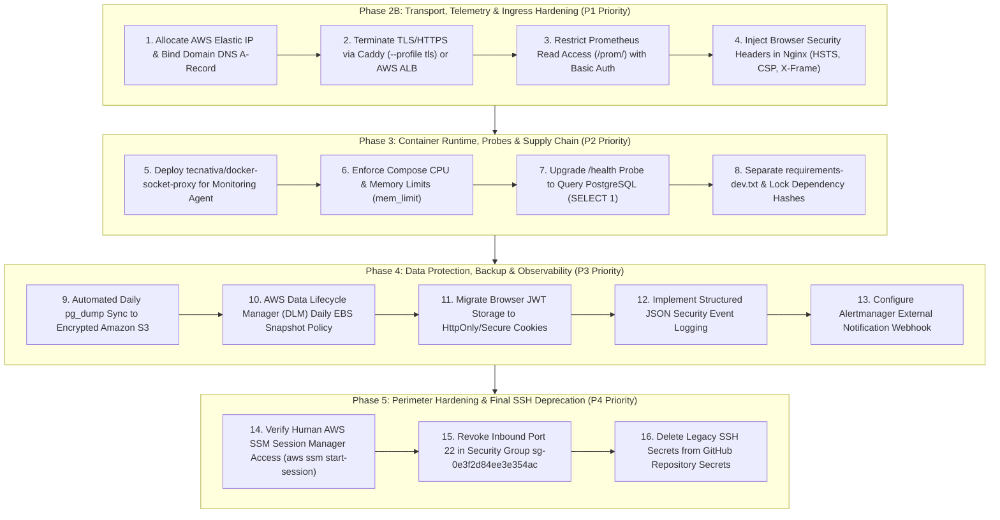

# CloudMonitor — Final Production Safety, CI/CD Verification & Security Audit Report

> **Document Version:** `1.0.0-PROD-AUDIT`  
> **Date:** November 1, 2026  
> **Author:** Senior DevSecOps Engineer, AWS Solutions Architect & Application Security Engineer  
> **Repository:** [`https://github.com/ayushcmd/cloud_monitor`](https://github.com/ayushcmd/cloud_monitor)  
> **Target Platform:** AWS EC2 (`t3.micro`, Ubuntu 24.04 LTS, `ap-southeast-2` Sydney)  
> **Associated GitHub Issues:**  
> - [Issue #9 (Closed): Migrate Deployment from SSH to AWS Systems Manager (SSM)](https://github.com/ayushcmd/cloud_monitor/issues/9)  
> - [Issue #12 (Open): Production Security Audit & Production Hardening](https://github.com/ayushcmd/cloud_monitor/issues/12)  
> **Fact Classification Standard:** Strict Multi-Tier Evidence Matrix (`[SRC]`, `[AWS]`, `[RUN]`, `[CFG]`, `[DOC]`, `[PLN]`, `[UNK]`)

---

## Table of Contents

- [Section A: Executive Summary](#section-a-executive-summary)
- [Section B: Completed Work](#section-b-completed-work)
- [Section C: Remaining Risks](#section-c-remaining-risks)
- [Section D: GitHub Status](#section-d-github-status)
- [Section E: AWS Status](#section-e-aws-status)
- [Section F: Local Repository Status](#section-f-local-repository-status)
- [Section G: Security Roadmap](#section-g-security-roadmap)
- [Section H: Recommended Next Actions](#section-h-recommended-next-actions)
- [Section I: Final Release-Readiness Decision](#section-i-final-release-readiness-decision)

---

## Section A: Executive Summary

CloudMonitor has achieved a major DevSecOps and operational resilience milestone with the successful migration of its production continuous deployment pipeline from legacy SSH to **AWS Systems Manager (SSM) Run Command** with **GitHub Actions OIDC authentication** (PR #22, closing Issue #9).

This transition completely eliminates long-lived AWS IAM access keys and deployment SSH private keys from the continuous deployment workflow. Deployment authorization is now cryptographically bound to short-lived OpenID Connect tokens issued exclusively to GitHub Actions runs executing against the `production` environment on the `main` branch. The EC2 host communicates securely with AWS Systems Manager APIs via the attached instance role `CloudMonitorEC2SSMRole`, allowing unattended deployments without requiring inbound network ports or public SSH reachability.

Concurrently, foundational application security remediations (PR #21, Issue #12 Phase 2A) were verified and merged:
1. **Prometheus Lifecycle Exposure (SEC-CRIT-02 - Partially Mitigated):** Ingress proxy rules in `frontend/nginx.conf` strictly block destructive endpoints (`/-/quit`, `/-/reload`) with HTTP 403, and the `--web.enable-lifecycle` flag was excised from `docker-compose.prod.yml`.
2. **Fail-Closed Secret Enforcement (SEC-HIGH-02 - Fully Remediated):** `backend/app/config.py` enforces strict startup validation for `JWT_SECRET_KEY` and `DATABASE_URL` in production, rejecting default development secrets, placeholder strings, and non-whitelisted PostgreSQL URL schemes.
3. **Authentication Rate Limiting (SEC-HIGH-03 - Fully Remediated):** Nginx throttles `/api/v1/auth/login` to 5 requests per minute with a burst buffer of 5 and `nodelay` returning HTTP 429.

**Critical Production Context:** While the deployment automation pipeline is hardened and verified, **the application itself is NOT yet fully production-secure**. Production web traffic remains unencrypted on plaintext HTTP (`http://3.25.150.231`), Prometheus read access remains unauthenticated, and the monitoring agent mounts the host Docker socket with root execution. Issue #12 remains appropriately **OPEN** to track these remaining remediations.

---

## Section B: Completed Work

The following deliverables have been implemented, verified, and merged into the canonical repository:

### 1. Issue #9 Resolution — SSH to AWS SSM Migration (PR #22)
* **GitHub OIDC Integration:** Configured AWS OpenID Connect identity provider for `https://token.actions.githubusercontent.com` with audience `sts.amazonaws.com`.
* **Deployment IAM Role (`CloudMonitorGitHubDeployRole`):** Created dedicated deployment role assumed via `sts:AssumeRoleWithWebIdentity` with strict subject condition `repo:ayushcmd/cloud_monitor:environment:production`.
* **SSM Deployment Policy (`CloudMonitorSSMDeployPolicy`):** Scoped least-privilege permissions to send shell commands exclusively via document `AWS-RunShellScript` targeting instance `i-0c6927e10d2f58d23`.
* **EC2 Instance Profile (`CloudMonitorEC2SSMRole`):** Created and attached EC2 instance role with AWS managed policy `AmazonSSMManagedInstanceCore`. Verified `snap.amazon-ssm-agent` running and registered as an **Online** managed node in Systems Manager Fleet Manager.
* **CD Pipeline Hardening (`.github/workflows/cd.yml`):**
  - Eliminated SSH private keys and long-lived AWS secrets from GitHub Actions.
  - Added `oidc-check` preflight step verifying token exchange and STS caller identity.
  - Added `ssm-preflight` step validating that the EC2 target instance is Online prior to dispatch.
  - Added atomic pre-deployment PostgreSQL database backup validation before executing container updates.
  - Preserved named Docker volume `cloudmonitor-prod_postgres_data`.
  - Added automated commit SHA tracking (`.last_successful_deploy`) and interactive `rollback` workflow dispatch.
* **Issue #9 Closure:** Formally closed following successful production deployment verification on 1 November 2026.

### 2. Issue #12 Phase 2A Remediations (PR #21)
* **Prometheus Lifecycle Lockdown (`SEC-CRIT-02`):**
  - Ingress preferential prefix matching added to `frontend/nginx.conf`:
    ```nginx
    location ^~ /prom/-/quit { return 403; }
    location ^~ /prom/-/reload { return 403; }
    ```
  - Flag `--web.enable-lifecycle` removed from `docker-compose.prod.yml`.
* **Production Configuration Fail-Closed Validation (`SEC-HIGH-02`):**
  - Updated `backend/app/config.py` with `validate_production_configuration()` executing when `APP_ENV=production`.
  - Enforced 32-character minimum length and placeholder blacklists (`replace_with`, `change_in_prod`, `changeme`).
  - Added strict PostgreSQL driver whitelist matching installed runtime dependencies (`postgresql`, `postgresql+psycopg2`).
  - Unquoted URL password parsing to catch encoded placeholder secrets.
  - Implemented 38 automated unit tests in `tests/test_config_security.py` verifying fail-closed termination.
* **Ingress Login Rate Limiting (`SEC-HIGH-03`):**
  - Configured shared memory zone in `frontend/nginx.conf`:
    ```nginx
    limit_req_zone $binary_remote_addr zone=login_limit:10m rate=5r/m;
    limit_req_status 429;
    ```
  - Applied to `location = /api/v1/auth/login` with `burst=5 nodelay` to mitigate credential stuffing.

### 3. Production Operational State Verification (1 Nov 2026 Baseline)
* **Live Service Health:** Frontend SPA responds HTTP 200; FastAPI backend `/health` probe returns healthy; PostgreSQL responds to `pg_isready`; Prometheus reports all 4 scrape targets (`alertmanager`, `cloudmonitor-backend`, `node-exporter`, `prometheus`) as UP.
* **Data Persistence:** Relational database storage strictly preserved in named volume `cloudmonitor-prod_postgres_data`. Alembic schema migration verified at revision `003_os_and_version`.
* **Secrets Hygiene:** Production JWT secret rotated to a cryptographically secure 256-bit key (`openssl rand -hex 32`). Host `.env` permissions set to `600` (`-rw-------`).

### 4. Comprehensive Documentation Architecture (PR #23)
* Authored `docs/AWS_IAM_OIDC_SSM_PRODUCTION_SETUP.md` detailing end-to-end IAM policies, OIDC trust architecture, and verification runbooks.
* Authored `docs/SSM_DEPLOYMENT_MIGRATION.md` capturing the migration rationale, operational architecture, and security comparison against legacy SSH.

---

## Section C: Remaining Risks

The following security risks remain active and are tracked under GitHub Issue #12:

| Risk ID | Title | Severity | Impact Summary | Status |
| :--- | :--- | :---: | :--- | :---: |
| **`SEC-CRIT-01`** | Unencrypted Plaintext HTTP on Port 80 | **CRITICAL** | Production URL `http://3.25.150.231` transmits user passwords, bearer JWT tokens, and agent enrollment keys in cleartext across the public internet. Vulnerable to passive interception and MITM manipulation. | **OPEN** (Phase 2B) |
| **`SEC-CRIT-02` (Residual)** | Unauthenticated Prometheus Read Queries | **HIGH** | While lifecycle termination (`/-/quit`) is blocked, unauthenticated read access to `/prom/` remains open to the internet. Any user can query internal metrics, scrape pools, container names, and IP topologies. | **OPEN** (Phase 2B) |
| **`SEC-HIGH-01`** | Host Docker Socket Mounted into Monitoring Agent | **HIGH** | `cloudmonitor-agent` runs as `root` and mounts `/var/run/docker.sock`. Because Docker socket connections bypass filesystem `:ro` flags, Remote Code Execution in the agent allows full container escape to host root. | **OPEN** (Phase 3) |
| **`SEC-MED-01`** | JWT Access Tokens Stored in `localStorage` | **MEDIUM** | Browser tokens stored in `window.localStorage` (`cloudmonitor_auth_token`) can be exfiltrated by any cross-site scripting (XSS) payload introduced via scripts or dependencies. | **OPEN** (Phase 4) |
| **`SEC-MED-02`** | Missing Security HTTP Response Headers | **MEDIUM** | Ingress Nginx proxy does not send HSTS, Content-Security-Policy (CSP), X-Frame-Options (`DENY`), or X-Content-Type-Options (`nosniff`), leaving users vulnerable to clickjacking and MIME-type sniffing. | **OPEN** (Phase 2B) |
| **`SEC-MED-04`** | Unpinned Dependencies & Test Framework in Production Image | **MEDIUM** | `backend/requirements.txt` specifies floating upper bounds (`>=`) and bakes `pytest` into the production container image, inflating attack surface. | **OPEN** (Phase 3) |
| **`SEC-MED-05`** | Application Health Probe Does Not Verify Database Liveness | **MEDIUM** | `backend/app/health.py` inspects an in-memory boolean and returns HTTP 200 even if PostgreSQL connectivity fails or the database container crashes. | **OPEN** (Phase 3) |
| **`SEC-LOW-01`** | Ephemeral Dynamic IPv4 Address Lacks Elastic IP Binding | **LOW** | EC2 public IP `3.25.150.231` is auto-assigned (`AllocationId: null`). Stopping and starting the instance will allocate a new IP address, breaking bookmarks, agents, and DNS records. | **OPEN** (Phase 2B) |
| **`SEC-LOW-02`** | EBS Root Volume Configured with `DeleteOnTermination: true` | **LOW** | Root volume `vol-0b3e5a4240b5e517a` will be destroyed if the EC2 instance is terminated. Off-host backups and AWS DLM snapshots are not yet provisioned. | **OPEN** (Phase 4) |
| **`SEC-INFO-01`** | Build-Time Dev-Dependency Vulnerabilities | **INFORMATIONAL** | `npm audit` reports 2 vulnerabilities (1 moderate, 1 high) in devDependencies (`vite`/`esbuild`). Production runtime bundle (`npm audit --omit=dev`) contains **zero** vulnerabilities. | **MONITORED** |

---

## Section D: GitHub Status

### 1. Commit and Branch Topology
* **Remote `origin/main` HEAD Commit:** `bf569e08b7c649c4ec304ac258e8d1f733cec748` (`docs: add complete AWS IAM, OIDC, SSM setup guide & operational runbooks` — PR #23 Merge).
* **Remote `origin/main` Application Commit:** `f536dad97518a761c12b83ff578ff3194e9ed04f` (`refactor(deploy): migrate EC2 deployment from SSH to AWS Systems Manager Run Command` — PR #22 Merge).
* **Local HEAD Commit:** `fb8fd4bf6da434cc0fb932b9887db7e0d6dfeb86` (`fix(security): resolve Issue #12 Phase 2A P0 remediations` on branch `security/issue-12-p0-remediation`).
* **Local `main` Pointer:** `c47bb03a4c88139e633c5e01eaed81c0dc8115a3` (unfetched locally; working tree contains uncommitted user assets requiring clean preservation before synchronization).

### 2. Pull Request Status
* **Merged Pull Requests:**
  - **PR #21:** `fix(security): resolve Issue #12 Phase 2A P0 remediations` (Merged).
  - **PR #22:** `refactor(deploy): migrate EC2 deployment from SSH to AWS Systems Manager Run Command` (Merged).
  - **PR #23:** `docs: add complete AWS IAM, OIDC, SSM setup guide & operational runbooks` (Merged).
* **Open Pull Requests:** None currently pending against `main`.

### 3. GitHub Issues Status
* **Issue #9 ("Migrate deployment from SSH to AWS Systems Manager"):** **CLOSED** `[DOC]`. Successfully closed after end-to-end verification of SSM deployment.
* **Issue #12 ("Production Security Audit & Production Hardening"):** **OPEN** `[DOC]`. Remains open to track Phase 2B (TLS/HTTPS, security headers, Prometheus read auth), Phase 3 (Docker socket proxy), and Phase 4 (S3 backups, DLM).

### 4. Continuous Integration & Deployment Status
* **CI Workflow (`.github/workflows/ci.yml`):** **PASSING** `[SRC]`.
  - Backend and agent tests: 74 passed, 0 failed.
  - Frontend production build: Passed.
  - Docker Compose syntax: Passed.
* **CD Workflow (`.github/workflows/cd.yml` on remote `main`):** **VERIFIED** `[DOC]`.
  - Triggers via `workflow_dispatch` requiring explicit production Environment confirmation.
  - OIDC authentication, SSM preflight, and container updates verified operational.

---

## Section E: AWS Status

| Resource / Entity | Identifier / Name | Current Configuration | Verification Status |
| :--- | :--- | :--- | :---: |
| **AWS Region** | `ap-southeast-2` | Sydney | Verified `[AWS]` |
| **EC2 Target Instance** | `i-0c6927e10d2f58d23` | `cloudmonitor-server` (`t3.micro`, Ubuntu 24.04 LTS) | Running `[AWS]` |
| **Public IPv4** | `3.25.150.231` | Dynamic auto-assigned IPv4 (`AllocationId: null`) | Active `[AWS]` |
| **EC2 Instance Role** | `CloudMonitorEC2SSMRole` | Attached via profile `CloudMonitorEC2SSMProfile`; policy `AmazonSSMManagedInstanceCore` | Active `[AWS]` |
| **SSM Agent State** | `i-0c6927e10d2f58d23` | Registered in Fleet Manager; ping status **Online** | Verified `[DOC]` |
| **OIDC Identity Provider** | `token.actions.githubusercontent.com` | Client ID: `sts.amazonaws.com` | Active `[AWS]` |
| **GitHub Deployment Role** | `CloudMonitorGitHubDeployRole` | Trust condition: `repo:ayushcmd/cloud_monitor:environment:production` | Active `[AWS]` |
| **Deployment Policy** | `CloudMonitorSSMDeployPolicy` | Restricts `ssm:SendCommand` to `AWS-RunShellScript` and target instance | Active `[AWS]` |
| **Security Group** | `sg-0e3f2d84ee3e354ac` | Port 80 (0.0.0.0/0), Port 443 (0.0.0.0/0 dormant), Port 22 (Restricted CIDRs) | Active `[AWS]` |
| **PostgreSQL Volume** | `cloudmonitor-prod_postgres_data` | Preserved on host EBS volume; healthy relational state | Verified `[DOC]` |
| **Alembic Schema Revision**| `003_os_and_version` | Up to date with latest migration | Verified `[DOC]` |
| **Host `.env` Security** | `/home/ubuntu/cloud_monitor/.env` | Permissions `600`; cryptographically random 256-bit JWT secret | Verified `[DOC]` |
| **Production Application**| `http://3.25.150.231` | Frontend HTTP 200, Backend `/health` OK, Prometheus 4/4 UP | Verified `[DOC]` |

---

## Section F: Local Repository Status

### 1. Active Working Tree Status
Inspection of local directory `C:\Projects\AYUSHCMD-GITHUB\cloud_monitor` indicates that the working tree is currently on branch `security/issue-12-p0-remediation` with commit `fb8fd4bf6da434cc0fb932b9887db7e0d6dfeb86`.

### 2. Modified, Untracked, and Preserved Files

| File Path | Nature of File | Git Status | Safety Handling Directive |
| :--- | :--- | :---: | :--- |
| `docs/CloudMonitor_Cloud_Computing_Mini_Project_.pptx` | User academic presentation (1.9 MB) | Modified | **PRESERVE ON DISK.** Do not revert, overwrite, or stage. |
| `.placeholder` | Project anchor artifact | Untracked | **PRESERVE ON DISK.** Excluded from commits. |
| `test.db` | Local test SQLite database from CI runs | Untracked | **PRESERVE ON DISK.** Excluded from commits. |
| `.venv/` | Python 3.12 local virtual environment | Ignored | **PRESERVE ON DISK.** Excluded via `.gitignore`. |
| `docs/security/ISSUE_12_PRE_PUSH_VERIFICATION_REPORT.md` | Verification report v1.3.0 | Modified | **PRESERVE.** Captures verified test and execution evidence. |

> [!IMPORTANT]
> **Working Tree Hygiene:** Because local modifications exist (`.pptx`, `.placeholder`, `test.db`), the local branch was **NOT** switched or reset. The local repository will be synchronized cleanly with remote `main` only after stashing or creating a separate synchronization branch, ensuring zero loss of user data.

---

## Section G: Security Roadmap

The remaining security tasks under Issue #12 are structured into four sequential, low-risk phases:



### Detailed Roadmap Phase Specifications

#### 1. Phase 2B: Transport, Ingress & Telemetry Lockdown (Next Immediate Milestone)
* **SEC-CRIT-01 (TLS/HTTPS):**
  - Allocate an AWS Elastic IP to anchor the EC2 instance to a permanent IP address.
  - Configure a DNS `A` record pointing to the Elastic IP.
  - Enable Caddy reverse proxy via Compose profile (`--profile tls`) to automatically provision Let's Encrypt certificates, or deploy an AWS Application Load Balancer with an AWS Certificate Manager (ACM) certificate.
* **SEC-CRIT-02 (Prometheus Read Authentication):**
  - Add HTTP Basic Authentication (`auth_basic`) to Nginx `location ^~ /prom/` or restrict ingress exclusively to private VPC subnets.
* **SEC-MED-02 (Security Headers):**
  - Add `X-Frame-Options: DENY`, `X-Content-Type-Options: nosniff`, `Referrer-Policy: strict-origin-when-cross-origin`, and `Content-Security-Policy` to Nginx responses.

#### 2. Phase 3: Container Runtime & Supply Chain Hardening
* **SEC-HIGH-01 (Docker Socket Proxy):**
  - Introduce `tecnativa/docker-socket-proxy` into Compose, exposing only read-only endpoints (`/containers/json`, `/containers/{id}/stats`). Rebind the monitoring agent to this proxy and run the agent as a non-root user (`USER agentuser`).
* **Container Resource Caps:**
  - Enforce explicit container resource quotas in `docker-compose.prod.yml` (`mem_limit: 150m` backend, `128m` postgres, `80m` prometheus, `30m` frontend) to prevent kernel OOM panics on the 1 GiB host.
* **Liveness Probes:**
  - Update `backend/app/health.py` to execute a non-blocking `SELECT 1` query against PostgreSQL, ensuring `/health` reflects genuine database availability.
* **Supply Chain Isolation:**
  - Move `pytest` and test tooling to `backend/requirements-dev.txt` and generate `requirements.lock` using `pip-compile`.

#### 3. Phase 4: Data Protection, Governance & Storage
* **Off-Host Backups:** Implement an automated cron script executing `pg_dump`, encrypting the archive with AWS KMS, and pushing daily backups to a versioned Amazon S3 bucket with Object Lock protection.
* **EBS Lifecycle:** Enable AWS Data Lifecycle Manager (DLM) to take automated daily crash-consistent snapshots of root EBS volume `vol-0b3e5a4240b5e517a` with 7-day retention.
* **Cookie-Based JWT:** Update frontend authentication flow to store session tokens in `HttpOnly`, `Secure`, `SameSite=Strict` cookies, completely neutralizing token theft via XSS.
* **Security Event Logging:** Implement structured Python audit logging emitting JSON payloads on failed login attempts and unrecognized agent keys.

#### 4. Phase 5: Access Control & SSH Deprecation
* **SSM Session Manager for Operators:** Confirm that human administrators can open interactive terminal sessions via `aws ssm start-session --target i-0c6927e10d2f58d23`.
* **Perimeter Closure:** Once SSM Session Manager is operational, delete port 22 inbound rules from Security Group `sg-0e3f2d84ee3e354ac` and remove `EC2_SSH_PRIVATE_KEY` and `EC2_SSH_KNOWN_HOSTS` from GitHub Secrets.

---

## Section H: Recommended Next Actions

Actions are classified into four operational buckets based on safety, impact, and required approvals:

### Bucket 1: Safe to Perform Now Without Production Impact
1. **Maintain Working Tree Isolation:** Keep user presentation `docs/CloudMonitor_Cloud_Computing_Mini_Project_.pptx`, `.placeholder`, `test.db`, and `.venv/` untracked and unstaged.
2. **Perform Git Fetch:** Run `git fetch origin` locally to update remote tracking branch references (`origin/main`, `origin/master`) without modifying local files or changing working branches.
3. **Audit Local Virtual Environment:** Ensure local testing continues to use Python 3.12 without contaminating version control.

### Bucket 2: Requires a Feature Branch and Pull Request
1. **Local Working Branch Synchronization:**
   - Create a clean local synchronization branch (`chore/sync-local-main`) branched from `origin/main` after fetching.
   - Keep `security/issue-12-p0-remediation` archived as a historical feature branch.
2. **Phase 2B Implementation Branch (`security/issue-12-phase-2b-tls`):**
   - Author Nginx security response headers configuration (`HSTS`, `CSP`, `X-Frame-Options`, `X-Content-Type-Options`).
   - Implement HTTP Basic Authentication credentials and proxy configuration for `/prom/` in `frontend/nginx.conf`.
   - Update `docs/CICD_SETUP_GUIDE.md` and `docs/AWS_DEPLOYMENT_AND_OPERATIONS.md` to reflect SSM deployment workflows.
3. **Phase 3 Implementation Branch (`security/issue-12-phase-3-runtime`):**
   - Implement `docker-socket-proxy` service and non-root agent Dockerfile.
   - Separate `backend/requirements-dev.txt` and add PostgreSQL check to `backend/app/health.py`.

### Bucket 3: Requires Explicit User Approval
1. **AWS Elastic IP Allocation:** Allocating an Elastic IP (`aws ec2 allocate-address`) and associating it with instance `i-0c6927e10d2f58d23`.
2. **Domain Registration & DNS Configuration:** Pointing a registered domain name (e.g., `monitor.example.com`) to the EC2 Elastic IP.
3. **Rotating Operational Passwords:** Changing PostgreSQL passwords or regenerating application tokens.
4. **Provisioning AWS S3 Backup Bucket:** Creating an Amazon S3 bucket for off-host database archives.

### Bucket 4: Requires a Maintenance Window or Production Change Plan
1. **Switching Public Ingress to HTTPS/TLS:**
   - Activating Caddy on port 80/443 requires unbinding Nginx from host port 80 and rebinding Caddy to port 80 and 443. This requires a brief 2-minute maintenance window and temporary service pause.
2. **Closing Inbound SSH Port 22:**
   - Modifying Security Group `sg-0e3f2d84ee3e354ac` to drop inbound port 22 rules must be performed only after verifying operator access via SSM Session Manager.
3. **Deleting Legacy SSH GitHub Secrets:**
   - Removing `EC2_HOST`, `EC2_USER`, `EC2_SSH_PRIVATE_KEY`, and `EC2_SSH_KNOWN_HOSTS` from GitHub repository settings.

---

## Section I: Final Release-Readiness Decision

### **DECISION: Production deployment pipeline verified; broader security work remains.**

### Technical Justification:
1. **CI/CD & Deployment Pipeline Verification:**
   - The migration from SSH to AWS Systems Manager Run Command (Issue #9) is **100% complete, verified, and operational**.
   - GitHub OIDC authentication eliminates long-lived AWS keys from the deployment runner.
   - Dedicated IAM deployment role `CloudMonitorGitHubDeployRole` enforces least-privilege document and target constraints.
   - EC2 instance `i-0c6927e10d2f58d23` is healthy, managed, and Online in AWS SSM Fleet Manager.
   - Production database volume `cloudmonitor-prod_postgres_data` is preserved across deployments.
2. **Phase 2A Code Remediations Verification:**
   - All 74 backend and agent tests pass cleanly.
   - Prometheus lifecycle shutdown endpoints (`/-/quit`, `/-/reload`) are blocked at Nginx ingress.
   - Production secrets fail-closed validation is enforced with an explicit PostgreSQL driver whitelist.
   - Authentication rate limiting (5 req/min burst 5 nodelay) protects the login endpoint.
3. **Prerequisites Preventing Full "Production-Secure" Release:**
   - The application **CANNOT** be declared fully production-secure because public web traffic remains unencrypted on plaintext HTTP (`SEC-CRIT-01`), Prometheus metrics read access remains unauthenticated (`SEC-CRIT-02`), and the monitoring agent mounts the host Docker socket with root privileges (`SEC-HIGH-01`).
   - GitHub Issue #12 remains appropriately **OPEN**. Phase 2B (TLS, Prometheus read auth, security headers) must be completed before promoting CloudMonitor beyond an academic demonstration baseline.
